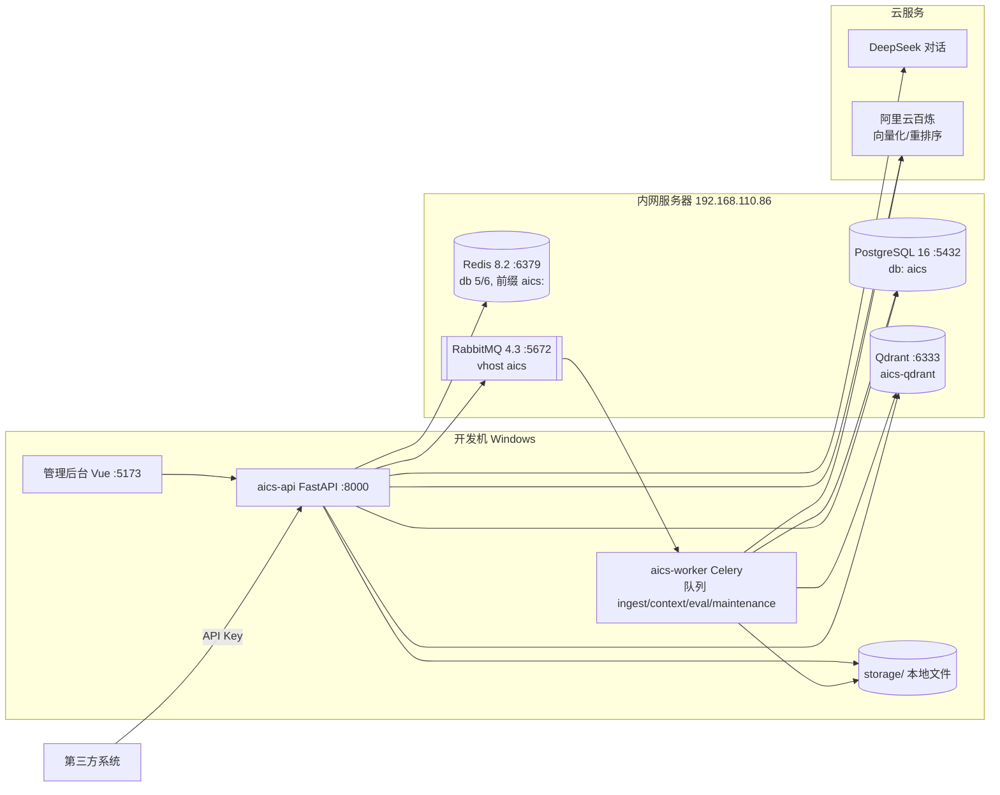

# 系统架构

## 1. 部署拓扑（开发期）

生产期：`aics-api`、`aics-worker`、`aics-web`（Nginx 托管前端并反代 API）以容器运行在服务器上，依赖不变。

## 2. 组件职责
| 组件 | 职责 |
|---|---|
| aics-api | HTTP 接口（开放 + 管理）、鉴权、限流、RAG 在线问答（流式） |
| aics-worker | 消费 Celery 队列：`ingest`（入库、替换、重建、重新分词）、`context`（会话压缩、消息向量化、出站 Webhook 投递）、`eval`（评测运行）、`maintenance`（清理、对账、统计）。生产环境 `context` 队列由独立 worker 进程消费 |
| aics-beat | Celery 定时任务（投递到 `maintenance` 队列）：空闲会话扫描 `idle_sweep`（每 30 秒：转人工排队超时、接入后无消息超时、关闭前提醒、空闲关闭）、删除兜底清理（每小时）、`aggregate_daily_stats` 每日统计（每小时刷新当天，00:30 定稿前一天）、`reconcile` 对账（每日）、保留期清理（每日）（与 worker 同镜像） |
| PostgreSQL | 业务数据、切块正文、全文检索（tsvector） |
| Qdrant | 切块向量 |
| Redis | 限流计数、缓存（应用配置、Key 校验结果）、Celery 结果、SSE 取消标志、会话事件 pub/sub（`aics:conv:{id}`） |
| RabbitMQ | Celery 任务队列 |

## 3. 关键数据流
**入库**：上传 → API 保存文件、写 `documents(queued)` → 投递 `ingest_document` → Worker 解析、切块、分词、向量化 → 写新构建号的 `chunks` 与 Qdrant → 事务切换生效版本 → `done`（见[文档处理流水线](04-文档处理流水线.md)）。

**问答**（`chat.service.handle_turn`）：请求 → 鉴权/限流 → 加载应用配置（缓存）→ 校验会话（状态、空闲过期）→ **落库 user 消息** → LangGraph 流程（经 `MemoryPort` 组装历史）→ SSE 推送 → **落库 assistant 消息**并更新会话（`refusal_streak`、`handoff`、计数）→ 按需投递压缩（队列 `context`）。

## 4. 请求链路中的横切关注点
- `request_id` 中间件（读取或生成 `X-Request-ID`，写入日志与响应头）。
- 统一异常处理 → 统一错误体。
- 鉴权依赖：`require_api_key(scope)`（API Key scope，见[安全设计 §2.1](../08-security/01-安全设计.md)）、`require_perm(permission, app_id)`（后台 RBAC 权限）。
- 指标：请求耗时直方图、LLM token 计数、各 RAG 节点耗时。
