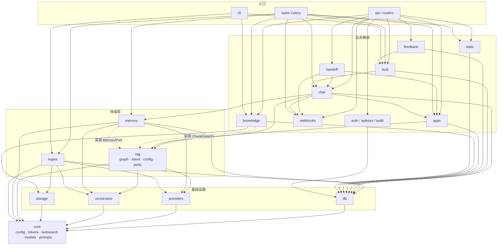

# 模块划分

后端采用"按业务模块分包 + 每个模块内分层"的结构：`router`（HTTP）→ `service`（业务）→ `repository`（数据库）。领域库（`rag`、`memory`、`ingest`）不含 HTTP 层，可在 API、worker、脚本、测试中复用。

> 本文描述 v1 的目标划分。"状态"列标明现在是否已有代码（截至 M3.5，2026-10-19）；未实现的部分标注落地子步骤，详见[实现现状与代码地图](../00-handoff/02-实现现状与代码地图.md)与[后续里程碑详细计划](../00-planning/06-后续里程碑详细计划.md)。

## 1. 模块表
| 层 | 模块 | 包 | 职责 | 允许依赖 | 状态 |
|---|---|---|---|---|---|
| L0 基础 | core | `aics.core` | 配置、日志、异常、安全工具（哈希、JWT）、依赖注入；`core.tokens`（唯一 token 计数工具）、`core.textsearch`（按应用缓存的 jieba 分词器 + tsquery 构造）、`core.models`（模型注册表 `AICS_MODELS`）、`core.prompts`（提示词文件加载与版本） | 第三方库 | ✅（`require_perm` / `audit` M4.1，`idempotency` M3.2，`schedule` M3.4） |
| L1 基础设施 | db | `aics.db` | 引擎、会话、Base、ORM 模型、`AppScopedRepository` 基类 | core | ✅ |
| | providers | `aics.providers` | LLM / Embedding / Rerank 抽象与实现 | core | ✅ |
| | vectorstore | `aics.vectorstore` | Qdrant 封装（强制 `app_id` 过滤） | core | ✅ |
| | storage | `aics.storage` | 文件存储接口与本地实现 | core | ✅（S3 v2） |
| L2 领域库 | ingest | `aics.ingest` | 解析器、切块器、分词、索引写入（版本化构建） | core, db, providers, vectorstore, storage | ✅ |
| | memory | `aics.memory` | 会话上下文：`load_context`（按 token 预算组装）、`compactor`（滚动摘要）、`facts`（事实抽取与逐轮槽位写入）、`recall`（会话内回查）、消息向量化；拥有 `ConversationStore` 接口及其 PG 实现 | core, db, providers, vectorstore | ✅（`recall` 与消息向量化 M5.4 视评测结论） |
| | rag | `aics.rag` | LangGraph 图、节点、提示词、检索器、引用处理；`rag.intent`（意图识别纯函数）；`rag.config`（`AppRagConfig` 唯一 schema）；`rag.ports`（rag 所需的外部接口） | core, providers, vectorstore；通过 `rag.ports` 接口使用 memory 与切块查询，**不 import** `db`、`modules`、FastAPI | ✅（向量快速通道 M5.5 视结论） |
| L3 业务模块 | auth | `aics.modules.auth` | 登录、刷新、用户、角色与权限、应用授权；`Authorizer` 实现 `core.security.require_perm`（由 main 注入）。**M4.1 ② 起**：argon2id 密码、PyJWT 双令牌与一次性轮换（复用即踢全端）、5 次失败锁 15 分钟、按 IP 限流、25 个点分权限与三角色、`/api/v1/admin/auth/*` 五个端点；**M4.1 ③ 起**：`/api/v1/admin/users` 的建/查/改/删与 `reset-password`、`/apps/{app_id}/members` 的查/设/删，全部写审计并在授权变更后立即失效身份与权限缓存 | core, db | ✅ ②③（④ 前端） |
| | apps | `aics.modules.apps` | 应用 CRUD、配置校验（调用 `rag.config`）、配置缓存、应用删除调度；`admin_service.py` + `admin_router.py` 提供管理接口的列表 / 详情 / 部分更新（`expected_config_version` 乐观校验）与 `retokenize_app` 投递 | core, db, rag.config, tasks（投递） | ✅ service + admin（② 读取与配置；创建 / 复制 / 删除与系统设置见 ③④） |
| | apikeys | `aics.modules.apikeys` | Key 生成/校验/吊销、scope 校验、限流、IP 白名单与使用标记（`keyusage`）；`ApiKeyAuthenticator` 实现 `core.security.Authenticator`（由 main 注入） | core, db | ✅ 核心（M2.6）+ `last_used_at`、IP 白名单（M3.1）；管理接口 M4.5 |
| | knowledge | `aics.modules.knowledge` | 文档上传/替换、列表、切块查询与复核、重建与删除调度；**开放接口 9 端点**（M3.2）；实现 `rag.ports.ChunkSearch`（关键词检索、按 id 取切块） | core, db, storage, tasks（投递） | ✅ service；开放接口已实现（M3.2），管理接口 M4.3 |
| | chat | `aics.modules.chat` | 对话接口、SSE、OpenAI 兼容层、调试对话、会话事件流；`chat.service` 是**唯一的对话编排入口**：会话生命周期（`chat.lifecycle`：空闲提醒与关闭、关闭后自动新建）、按转人工状态分派、消息落库、调用 rag 图、更新会话状态、触发压缩、发布会话事件（`chat.events`） | core, db, rag, memory, apps, webhooks | ✅ `service` / `router`（`/chat`、消息、`/events`）/ `sse` / `lifecycle` + **OpenAI 兼容 `openai.py` / `openai_router.py`（M3.3：`/v1/models`、`/v1/chat/completions`，无状态会话 `close_reason=stateless`）** + **转人工联动（M3.4：`append_agent_message` 是坐席消息与系统提示的唯一写入口，`_write_assistant` 维护 `handoff_*` / `callback_*` 列，非服务时间写 `system/handoff_offline`）** + **事件（M3.5：`events.emit` / `emit_all` 同事务写 `conversation_events` 与投递行，`events.publish_pending` 提交后广播，`event_stream.stream` 提供 SSE 补发与实时推送）**；调试对话 M4.4 |
| | feedback | `aics.modules.feedback` | 反馈、反馈转评测用例 | core, db, eval | M3.6（转用例 M5.3） |
| | eval | `aics.modules.eval` | 评测集、运行、指标计算；运行时调用 `chat.service`（`RunMode.eval`） | core, db, chat | M5.1–M5.3 |
| | handoff | `aics.modules.handoff` | 转人工状态机（none/pending/accepted/released）、人工坐席入站接口、排队超时与接入后无消息超时扫描、后台释放；写消息经 `chat.service` | core, db, chat, webhooks, apps（ADR-0017） | ✅ `schemas` / `repository` / `service` / `sweep` / `runtime` / `router`（M3.4：5 个坐席端点、状态机、两种超时扫描；M3.5 起每个写动作在同一事务里发事件） |
| | webhooks | `aics.modules.webhooks` | 出站 Webhook：payload 构造（固定格式）、签名、密钥加密、投递记录、重试与重发；事件本身由 `chat.events` 写入 `conversation_events`（ADR-0016） | core, db | ✅ `payloads` / `signing` / `service` / `repository`（M3.5：投递、退避重试、`send_test`、`redeliver`、投递前 SSRF 重校验）；管理接口 M4.5 |
| | stats | `aics.modules.stats` | 读取 `app_daily_stats` 提供仪表盘接口；每日聚合 service（聚合查询可只读使用 `db.models`，ADR-0017） | core, db | M4.6 |
| | audit | `aics.modules.audit` | 审计写入（`PgAuditSink` 实现 `core.audit.AuditSink`，只在业务事务内 `session.add`、不自己提交）与查询（`GET /api/v1/admin/audit`、`/audit/actions`，游标分页）；`audit_logs` 是全局表，不是 `AppScopedRepository` | core, db | ✅ M4.1 ③（时间范围筛选与导出在 M4.6） |
| L4 入口 | api | `aics.main` + 各模块 `router` | FastAPI app factory、中间件、路由注册 | L3 各模块 service | ✅ |
| | tasks | `aics.tasks` | Celery app 与任务定义（薄封装） | L2/L3 的 **service**（`ingest.service`、`memory.service`、`eval.service`、`stats.service`、`knowledge.service`、`apps.service`） | ✅（ingest、context、maintenance、webhooks；eval M5.2，stats M4.6） |
| 工具 | cli | `aics.cli` | `aics-cli`：version、reindex、reconcile、apikey、sweep-idle；bootstrap-admin、eval | 同 tasks | ✅（bootstrap-admin M4.1、eval M5.2 为占位） |

## 2. 依赖图

> 虚线表示"实现 rag 定义的接口"：`rag` 只依赖 `rag.ports` 中的 Protocol，具体实现由 `chat.service` 在调用图时注入（依赖倒置），因此 `rag` 不依赖 `memory`、`knowledge` 的实现代码，也不依赖 `db`。

## 3. 依赖规则（CI 用 import-linter 校验）
1. 只允许**向下**依赖（L4 → L3 → L2 → L1 → L0）；同层之间只允许表中列出的直接依赖（`chat → apps`、`chat → webhooks`、`handoff → chat`、`handoff → webhooks`、`handoff → apps`、`eval → chat`、`feedback → eval`），禁止循环。经允许的直接依赖叠加出的间接依赖（如 `handoff → chat → apps`、`eval → chat → webhooks`）不算违规：这几个 forbidden 合同设 `allow_indirect_imports = true`（[ADR-0017](adr/0017-模块依赖合同修订与横切能力注入.md)，M3.4 第一个提交修改 `pyproject.toml`）。
2. 模块之间只调用对方的 `service`（或 `rag.ports` 接口）；`router` 不直接访问 `repository`；一个模块不得 import 另一个模块的 `repository`。
3. `rag` 不 import `aics.db`、`aics.modules.*`、`fastapi`；需要的数据只通过 `rag.ports`（`MemoryPort`、`ChunkSearch`）获取，或由调用方放入输入参数。
4. `memory` 不 import `aics.rag`（配置值由调用方以参数传入），也不 import `aics.modules.*`。
5. Celery 任务（`aics.tasks`，含 `idle_sweep`、`deliver_webhook`）只做参数解析、`asyncio.run` 与重试策略，**只调用 service**，不写 SQL、不直接调用 repository 或 provider。
6. 所有带 `app_id` 的表的 repository 继承 `AppScopedRepository`（见 §5）。
7. `AppRagConfig`（含 `IntentConfig`）、`HandoffConfig`、`ChunkConfig`、`SessionConfig`（含生效值 `EffectiveSessionConfig`）、`WebhookConfig` 只在 `aics/rag/config.py` 定义（切块预设在同目录 `chunk_presets.yaml`）；`apps` 模块负责持久化（`apps.rag_config` 等 jsonb 列）与缓存，读出后用该 schema 校验并补齐默认值；其他地方不得重复定义配置结构。
8. 横切能力不靠模块间 import：API Key 鉴权（`core.security.Authenticator`，已实现）、后台权限（`core.security.require_perm` → `Authorizer`，M4.1）、审计（`core.audit.AuditSink`，M4.1）都在 core 定义 Protocol，由对应模块实现、`aics.main` 注入 `app.state`（ADR-0017）。
9. `main`、`tasks`、`cli` 互不 import：API 投递任务用独立 Celery 实例按任务名 `send_task`（见 `main.build_chat_runtime`），任务名与队列以 `tasks/celery_app.py` 的 `task_routes` 为准。

## 4. 职责划分：chat / rag / memory
| 职责 | 归属 |
|---|---|
| 会话创建、归属与状态校验（`status`、空闲过期、`channel`） | `chat.service` |
| user 消息落库（**生成前**，含 `token_count`、`search_text`） | `chat.service` |
| 调用 rag 图并消费流式事件 | `chat.service` |
| 意图识别、检索、判断、生成、引用解析 → 返回 `RagResult` | `rag`（不写库） |
| 历史组装（facts → summary → 近期原文 → 回查） | `memory.load_context`（rag 经 `MemoryPort` 调用） |
| assistant 消息落库（生成完成后；客户端断开时带 `interrupted=true`；出错时 `answer_type=error`），含 `prompt_version`、`intent*`、引用、token、耗时 | `chat.service` |
| `refusal_streak`、`handoff_status`（none/released → pending）、`message_count`、`last_message_at`、`last_activity_at` 更新 | `chat.service` |
| 按 `handoff_status` 与 `handoff_ai_mode` 决定本轮是否调用 rag（见[会话生命周期与转人工 §3.2](09-会话生命周期与转人工.md)） | `chat.service` |
| pending → accepted → released、人工回复写入 | `handoff.service`（经 `chat.service` 写消息） |
| 空闲提醒与关闭 | `chat.lifecycle`（beat `idle_sweep` 调用） |
| 排队超时、接入后无消息超时、待回访标记 | `handoff.sweep.sweep()`（M3.4 起 `idle_sweep` 先调用它，再调用 `chat.lifecycle.sweep()`；M2.7 只有后者） |
| 服务时间判断（触发转人工时） | `core.schedule.in_service_hours`（纯函数，`chat.service` 调用，避免 chat ↔ handoff 环；M3.4） |
| 会话事件发布与 Webhook 投递 | `chat.events`（事务内写 `conversation_events`，提交后 Redis 通知）→ `webhooks.service`（队列 `context`）；M3.5，ADR-0016 |
| 逐轮槽位写入关键事实（`enable_facts`，默认 true） | `chat.service` 调用 `memory.service.capture_slots` |
| 压缩触发判断与执行（online/debug 异步投递，eval 同步） | `chat.service` 调用 `memory.service.maybe_compact(run_mode)` |
| 消息向量化（`enable_history_recall` 且系统开启时） | `memory.service`（异步任务；M5.4 视评测结论） |

调试对话（`/admin/.../debug/chat`，M4.4）、评测运行（`eval`，M5.2）、OpenAI 兼容接口（M3.3）全部复用 `chat.service.handle_turn()`，区别只在 `channel` 与 `RunMode`（见 [RAG 流程设计 §2](03-RAG流程设计.md)），不得各自拼装流程。

## 5. AppScopedRepository
```python
class AppScopedRepository(Generic[M]):
    model: type[M]                      # 必须有 app_id 列
    def _scoped(self, app_id: UUID) -> Select:   # 所有查询的起点，自动加 WHERE app_id = :app_id
        return select(self.model).where(self.model.app_id == app_id)
    async def get(self, app_id: UUID, id: UUID) -> M | None: ...
    async def list(self, app_id: UUID, *, filters: ..., page: ...) -> list[M]: ...
    async def update(self, app_id: UUID, id: UUID, **values) -> int: ...   # UPDATE ... WHERE app_id AND id
    async def delete(self, app_id: UUID, id: UUID) -> int: ...
```
- 子类新增的方法第一个参数必须是 `app_id`，且只能基于 `_scoped()` 或带 `app_id` 条件的语句构造查询；单元测试遍历所有子类方法签名校验。
- `apps` 自身即租户：ORM 中 `App.app_id` 是 `id` 的同义属性（synonym），`AppRepository` 同样继承本基类；`user_app_roles` 为复合主键，通用方法中的 `id` 即 `user_id`。
- 全局表（`users`、`roles`、`audit_logs`、`app_daily_stats` 的跨应用汇总除外）使用普通 repository。
- 跨应用操作（`reindex_all`、全局仪表盘）只能在 service 层逐应用调用，或使用显式命名为 `*_all_apps` 的方法并只对 super_admin 开放。
