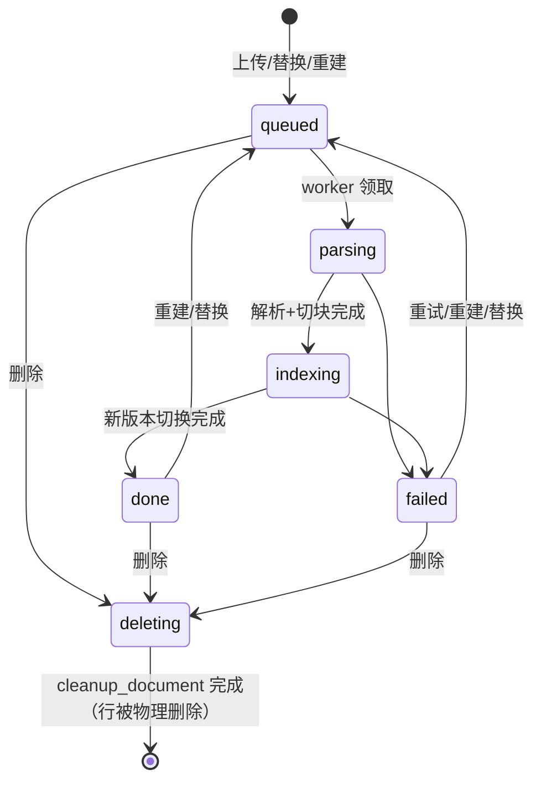

# 文档处理流水线

## 1. 状态机

- `status` 描述**最近一次构建**；构建期间（queued/parsing/indexing）以及构建失败（failed）时，若文档已有生效版本（`index_version > 0`），旧版本继续可检索。后台以"生效版本 vN · 正在构建 vN+1"形式展示。
- `progress`（0–100）：parsing 占 0–30，indexing 按已向量化批次占 30–100。
- 处于 `deleting` 的文档不可检索、不可重建/替换（`409 DOCUMENT_BUSY`）。

## 2. 版本字段
| 字段 | 含义 |
|---|---|
| `documents.version` | 文件版本：首次上传 1，每次替换（FR-KB-08）+1 |
| `documents.index_version` | 当前**生效**的构建号（0 = 尚无可用版本）；只有生效版本的切块参与检索 |
| `documents.pending_index_version` | 正在构建的构建号，无构建时为 NULL |
| `documents.chunk_config_version` | 生效版本使用的 `apps.chunk_config_version`；小于应用当前值时后台提示"需重建" |
| `chunks.index_version` | 切块所属构建号 |

构建号对每个文档单调递增（`max(index_version, pending_index_version) + 1`），上传、替换、重建都生成新构建号。

## 3. 步骤
1. **接收**（API，`knowledge.service`）：校验大小、扩展名 + 魔数；计算 SHA-256；同应用存在未删除的相同哈希 → 返回已有文档（HTTP 200，`duplicate=true`）；存储路径 `storage/{app_id}/{document_id}/v{version}.{ext}`；写 `documents(queued, version=1, index_version=0, pending_index_version=1)` 与 `jobs(type=ingest)`，投递 `ingest_document`（队列 `ingest`）。
2. **解析**（worker）：统一输出 `ParsedDoc(blocks=[Block(type=heading|paragraph|table|list, level, text, page)])`。
   - PDF：PyMuPDF `page.get_text("dict")`，按字号推断标题层级；去页眉页脚（多页重复行）。
   - DOCX：python-docx，按样式 Heading 1–6；表格转 Markdown 表。
   - HTML/URL：trafilatura 提取正文（`output_format="markdown"`），URL 抓取限时 15s、≤ 10MB、默认禁止私网地址（防 SSRF，白名单见安全设计 §4）。
   - MD/TXT：MD 按 `#` 标题；TXT 按空行分段，自动检测编码。
   - 实现细节（M1.3，参照常见 RAG 平台做法）：
     - 文件类型：扩展名白名单（`pdf/docx/md/markdown/txt/html/htm`）+ 魔数（PDF `%PDF-`；DOCX 为含 `word/` 的 zip；文本类不得含 NUL 字节），不符 → `400 UNSUPPORTED_FILE_TYPE`。
     - 编码：BOM → UTF-8 严格解码 → charset-normalizer 检测；GB2312/GBK 一律按 GB18030 解码。
     - PDF：正文字号取按字符数加权的众数，字号 ≥ 正文 × 1.15 且 ≤ 60 字的行为标题，按字号映射 1–3 级；页眉页脚 = 页面上下 8% 区域内、去数字后在 ≥ 50%（至少 3 页）页面重复的行，以及纯页码行；表格用 `page.find_tables()` 整表转 Markdown；跨页未以句末标点结束的段落与下一页首段合并；加密 PDF、无文本层（扫描件，v1 不做 OCR）→ 解析失败。
     - DOCX：样式 `Heading 1–6` / `标题 1–6` / `Title` 为标题；列表样式或带编号的段落合并为列表块；合并单元格只取一次。
     - Markdown：支持 ATX 与 Setext 标题、表格（缺分隔行时补齐）、列表、代码块（块内 `#` 不当标题）；去掉 front matter 与图片，链接只保留文字。HTML 经 trafilatura 转出的 Markdown 同样按此解析，`<title>` 记为文档内标题。
     - URL：最多 5 跳重定向，每跳重新做 SSRF 校验，连接建立后再校验实际对端 IP（防 DNS rebinding）；只接受 HTML / 纯文本 / Markdown / PDF / DOCX 内容类型。
     - 解析失败抛 `ParseError`（消息为用户可读原因，写入 `documents.error`）。
3. **切块**：维护标题栈得到 `heading_path`；在同一章节内累加段落到 `chunk_size`（500 token），超长段落按句号/换行再切；相邻块重叠 `chunk_overlap`（80 token）；表格尽量整块不拆。细则（`ingest/chunker.py`）：切块与重叠都不跨章节（标题变化即边界），标题只进 `heading_path` 不进正文，只有标题没有正文的章节不产生切块；重叠取上一块末尾不超过 `chunk_overlap` 的完整句子（单句超出时取其末尾片段），表格不作为重叠来源，加上重叠会超过 `chunk_size` 时缩减重叠；单句超长按 token 二分硬切；表格超过 `chunk_size` 时按行拆分并在每块重复表头。token 数一律用 `aics.core.tokens.count_tokens()`（全系统唯一的计数规则，见 §7）。
4. **分词**：`core.textsearch.get_tokenizer(app_id, custom_dict)` 取该应用的 `jieba.Tokenizer` 实例（按 `(app_id, custom_dict 哈希)` LRU 缓存，**不修改 jieba 全局词典**），`lcut_for_search(heading_path + " " + text)` 空格连接写入 `chunks.search_text`，生成列 `tsv = to_tsvector('simple', search_text)`。
5. **注入检测**：对切块正文匹配典型注入短语（安全设计 §3.5），命中 → `review_status='flagged'`、`flag_reason` 记录命中短语；flagged 切块在管理员复核通过前不参与检索。
6. **向量化**：向量化文本 = `"{heading_path}\n{text}"`（**不含文档标题**；标题只作为 PG 元数据在生成与引用时联表读取，改标题无需重新向量化）；批量（`AICS_EMBED_BATCH`=10），并发 ≤ 4，429 时退避。
7. **写入**：PG 批量插入新构建号的 chunks；Qdrant upsert（point id = chunk_id，payload 见 Qdrant 设计）。
8. **切换**（单个 PG 事务）：`UPDATE documents SET index_version = pending_index_version, pending_index_version = NULL, status='done', progress=100, chunk_count=…, chunk_config_version=…`（替换时同时更新 `content_hash`、`storage_key`、`mime_type`、`size_bytes`、`version`）。事务提交即完成新旧版本的原子切换：检索回 PG 取切块时条件为 `chunks.index_version = documents.index_version`，旧版本向量即使仍在 Qdrant 也会被过滤掉。
9. **清理旧版本**：切换后投递 `cleanup_document(document_id, below_index_version=新版本)`（队列 `maintenance`）：删 Qdrant 中该文档旧构建号的点、删旧 chunks 行；替换时删旧文件。

## 4. 幂等与重建
- 任务参数只有 `document_id` 和 `job_id`；开始时读取 `pending_index_version`，先删除该构建号下可能残留的半成品（PG 与 Qdrant 按 `document_id + index_version` 过滤），再重写，因此重复执行结果一致，且不影响生效版本。
- 任务开始时与每个向量化批次之间检查应用与文档状态：应用 `status='deleting'` 或文档 `status='deleting'` → 立即中止，job 标记 `cancelled`，不再写入。
- **重建触发**：

| 变化 | 动作 | job type |
|---|---|---|
| 应用 `chunk_config` 变化 | `apps.chunk_config_version` +1；提示并可一键对该应用全部文档重建（重新解析、切块、向量化） | `reindex_app` |
| 单文档"重建" | 同上，仅一个文档 | `reindex_document` |
| 应用 `custom_dict` 变化 | 只重新分词：重算该应用 chunks 与 messages 的 `search_text`（tsv 自动更新），不重新向量化、不改构建号 | `retokenize_app` |
| 平台 embedding 模型/维度变化 | 新集合全量重新向量化（不重新解析），完成后切换 `AICS_EMBED_MODEL` 指向的集合（见 Qdrant 设计） | `reindex_all` |
| 修改文档标题 | 无（标题不进入向量化文本） | — |

- 所有重建记录在 `jobs` 表，后台可看进度。

## 5. 替换文档（FR-KB-08）
- 接口：`PUT /api/v1/apps/{app_id}/documents/{document_id}/file`（开放接口 `kb:write`；后台同路径 S,A），multipart `file`；**文档 ID 不变**。
- 哈希规则：
  1. 新文件哈希 = 本文档当前 `content_hash` → 200，`{"unchanged": true}`，不构建；
  2. 新文件哈希 = 同应用另一个未删除文档 → `409 DUPLICATE_DOCUMENT`，`details.document_id` 为已有文档；
  3. 否则保存为 `v{version+1}.{ext}`，分配 `pending_index_version`，job `type=replace`（payload 含新文件哈希与存储键），返回 202。
- 文档处于 `queued/parsing/indexing/deleting` 时不能替换（`409 DOCUMENT_BUSY`）。
- 构建成功后按 §3 第 8 步原子切换（同时更新 `content_hash` 等文件字段与 `version`）；失败时旧版本保持生效，新文件删除，`status=failed` 并显示原因。唯一索引 `(app_id, content_hash)` 在切换事务中再次兜底校验，冲突则构建失败。

## 6. 删除
- 删除文档：`status='deleting'`、`deleted_at=now()`，其 chunks `enabled=false`（立即不可检索）→ 投递 `cleanup_document`（job `cleanup_document`）：删 Qdrant 点、删 chunks 行、删文件，最后物理删除 documents 行（审计日志保留删除记录）。
- 删除应用：见[安全设计 §2](../08-security/01-安全设计.md) 与管理接口：`apps.status='deleting'` → job `cleanup_app` 依次删除会话、消息、事实、评测、文档、切块、向量与文件，完成后写 `apps.deleted_at`。进行中的任务按 §4 检查状态后中止。
- beat 每小时兜底：清理 `deleting` 超过 1 小时未完成的对象与 Qdrant 中无对应 PG 行的点。

## 7. Token 计数（`aics.core.tokens`）
- 全系统只有一个函数 `count_tokens(text: str) -> int`，固定使用 tiktoken `cl100k_base` 编码作为**估算口径**；用于：切块长度、`chunks.tokens`、`messages.token_count`、上下文预算、模型窗口 80% 校验。
- 不按各模型的真实分词器计数（DeepSeek 等分词器与 cl100k 有偏差，中文约 ±15%）；预算与窗口校验都留有余量（80%）吸收误差。计费与用量统计使用供应商返回的 `usage`，不用估算值。
