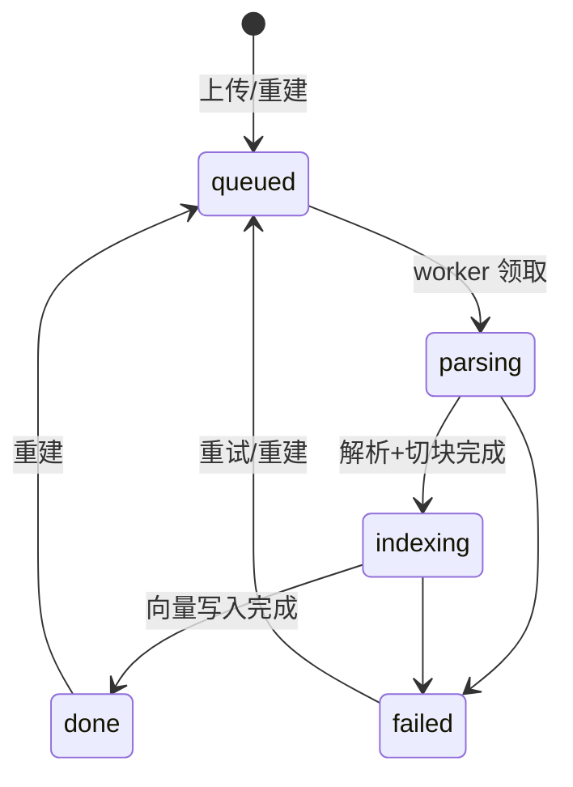

# 文档处理流水线

## 1. 状态机

`progress`（0–100）：parsing 占 0–30，indexing 按已向量化批次占 30–100。

## 2. 步骤
1. **接收**（API）：校验大小、扩展名 + 魔数；计算 SHA-256；同应用存在未删除的相同哈希 → 返回已有文档（HTTP 200，`duplicate=true`）；存储路径 `storage/{app_id}/{document_id}/original.{ext}`。
2. **解析**（worker）：统一输出 `ParsedDoc(blocks=[Block(type=heading|paragraph|table|list, level, text, page)])`。
   - PDF：PyMuPDF `page.get_text("dict")`，按字号推断标题层级；去页眉页脚（多页重复行）。
   - DOCX：python-docx，按样式 Heading 1–6；表格转 Markdown 表。
   - HTML/URL：trafilatura 提取正文（`output_format="markdown"`），URL 抓取限时 15s、≤ 10MB、禁止内网地址（防 SSRF）。
   - MD/TXT：MD 按 `#` 标题；TXT 按空行分段，自动检测编码。
3. **切块**：维护标题栈得到 `heading_path`；在同一章节内累加段落到 `chunk_size`（500 token），超长段落按句号/换行再切；相邻块重叠 `chunk_overlap`（80 token）；表格尽量整块不拆。token 用 tiktoken `cl100k_base` 估算（只用于长度控制）。
4. **分词**：`jieba.lcut_for_search(heading_path + text)` + 应用词典，空格连接写入 `chunks.search_text`，由生成列 `tsv = to_tsvector('simple', search_text)`。
5. **向量化**：向量化文本 = `"{doc_title}\n{heading_path}\n{text}"`；批量（`AICS_EMBED_BATCH`=10），并发 ≤ 4，429 时退避。
6. **写入**：PG 事务内批量插入 chunks；Qdrant upsert（point id = chunk_id）；全部成功后更新 `done`、`chunk_count`。

## 3. 幂等与重建
- 任务参数只有 `document_id` 和 `job_id`；开始时删除该文档旧 chunks 与向量（按 `document_id` filter），再重写，因此重复执行结果一致。
- **重建触发**：应用 `chunk_size/overlap` 变化 → 该应用全部文档重建；平台 embedding 模型/维度变化 → 新集合全量重建，完成后切换 `AICS_EMBED_MODEL` 指向的集合（见 Qdrant 设计）。
- 重建记录在 `jobs` 表，后台可看进度。

## 4. 删除
API：`documents.deleted_at=now()`，其 chunks `enabled=false`（立即不可检索）→ 投递 `cleanup_document`：删 Qdrant 点、删 chunks 行、删文件。定时任务每小时兜底清理遗漏。
