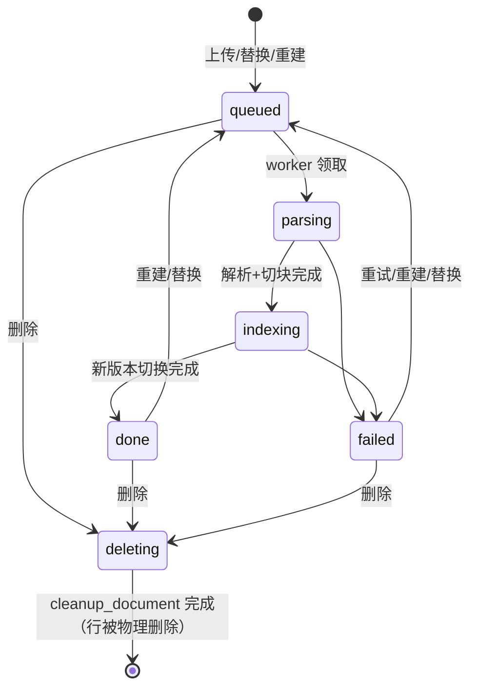

# 文档处理流水线

## 1. 状态机

- `status` 描述**最近一次构建**；构建期间（queued/parsing/indexing）以及构建失败（failed）时，若文档已有生效版本（`index_version > 0`），旧版本继续可检索。后台以"生效版本 vN · 正在构建 vN+1"形式展示。
- `progress`（0–100）：parsing 占 0–30，indexing 按已向量化批次占 30–100。
- 处于 `deleting` 的文档不可检索、不可重建/替换（`409 DOCUMENT_BUSY`）。

## 2. 版本字段
| 字段 | 含义 |
|---|---|
| `documents.version` | 文件版本：首次上传 1，每次替换（FR-KB-08）+1 |
| `documents.index_version` | 当前**生效**的构建号（0 = 尚无可用版本）；只有生效版本的切块参与检索 |
| `documents.pending_index_version` | 正在构建的构建号，无构建时为 NULL |
| `documents.chunk_config_version` | 生效版本使用的 `apps.chunk_config_version`；小于应用当前值时后台提示"需重建" |
| `chunks.index_version` | 切块所属构建号 |

构建号对每个文档单调递增（`max(index_version, pending_index_version) + 1`），上传、替换、重建都生成新构建号。

## 3. 步骤
1. **接收**（API，`knowledge.service`）：校验大小、扩展名 + 魔数；计算 SHA-256；同应用存在未删除的相同哈希 → 返回已有文档（HTTP 200，`duplicate=true`）；存储路径 `storage/{app_id}/{document_id}/v{version}.{ext}`；写 `documents(queued, version=1, index_version=0, pending_index_version=1)` 与 `jobs(type=ingest)`，投递 `ingest_document`（队列 `ingest`）。
2. **解析**（worker）：统一输出 `ParsedDoc(blocks=[Block(type=heading|paragraph|table|list, level, text, page)])`。
   - PDF：PyMuPDF `page.get_text("dict")`，按字号推断标题层级；去页眉页脚（多页重复行）。
   - DOCX：python-docx，按样式 Heading 1–6；表格转 Markdown 表。
   - HTML/URL：trafilatura 提取正文（`output_format="markdown"`），URL 抓取限时 15s、≤ 10MB、默认禁止私网地址（防 SSRF，白名单见安全设计 §4）。
   - MD/TXT：MD 按 `#` 标题；TXT 按空行分段，自动检测编码。
   - 实现细节（M1.3，参照常见 RAG 平台做法）：
     - 文件类型：扩展名白名单（`pdf/docx/md/markdown/txt/html/htm`）+ 魔数（PDF `%PDF-`；DOCX 为含 `word/` 的 zip；文本类不得含 NUL 字节），不符 → `400 UNSUPPORTED_FILE_TYPE`。
     - 编码：BOM → UTF-8 严格解码 → charset-normalizer 检测；GB2312/GBK 一律按 GB18030 解码。
     - 质量：解码后无法解码字符（U+FFFD）占非空白字符 >5% 视为乱码，失败并提示“文本疑似乱码”；所有格式统一清除 C0/C1 控制字符（含 DEL 0x7F、0x80–0x9F），仅保留换行与制表符。
     - PDF：正文字号取按字符数加权的众数，字号 ≥ 正文 × 1.15 且 ≤ 60 字的行为标题，按字号映射 1–3 级；页眉页脚 = 页面上下 8% 区域内、去数字后在 ≥ 50%（至少 3 页）页面重复的行，以及纯页码行；表格用 `page.find_tables()` 整表转 Markdown；跨页未以句末标点结束的段落与下一页首段合并；加密 PDF、无文本层（扫描件，v1 不做 OCR）→ 解析失败。
     - DOCX：样式 `Heading 1–6` / `标题 1–6` / `Title` 为标题；列表样式或带编号的段落合并为列表块；合并单元格只取一次。
     - Markdown：支持 ATX 与 Setext 标题、表格（缺分隔行时补齐）、列表、代码块（块内 `#` 不当标题）；去掉 front matter 与图片，链接只保留文字。HTML 经 trafilatura 转出的 Markdown 同样按此解析，`<title>` 记为文档内标题。
     - URL：最多 5 跳重定向，每跳重新做 SSRF 校验，连接建立后再校验实际对端 IP（防 DNS rebinding）；只接受 HTML / 纯文本 / Markdown / PDF / DOCX 内容类型。
     - 解析失败抛 `ParseError`（消息为用户可读原因，写入 `documents.error`）。
2.5 **预处理**（M1.4，`chunk_config` 开关，参照 Dify）：`normalize_whitespace`（默认 true）把行内连续空白合并为一个空格、连续 3 个以上换行合并为空行；`remove_urls_emails`（默认 false）删除 URL 与邮箱地址。只作用于段落 / 列表文本，不改表格结构，不改代码块以外的标题。预处理后为空的块丢弃。
3. **切块**：维护标题栈得到 `heading_path`；在同一章节内累加段落到 `chunk_size`（500 token），超长段落按句号/换行再切；相邻块重叠 `chunk_overlap`（80 token）；表格尽量整块不拆。细则（`ingest/chunker.py`）：切块与重叠都不跨章节（标题变化即边界），标题只进 `heading_path` 不进正文，只有标题没有正文的章节不产生切块；重叠取上一块末尾不超过 `chunk_overlap` 的完整句子（单句超出时取其末尾片段），表格不作为重叠来源，加上重叠会超过 `chunk_size` 时缩减重叠（缩减后仍只保留完整句子，一句都放不下则该块不重叠）；单句超长按 token 二分硬切；表格超过 `chunk_size` 时按行拆分并在每块重复表头。token 数一律用 `aics.core.tokens.count_tokens()`（全系统唯一的计数规则，见 §7）。
   - **切块配置与预设**（M1.3b）：`apps.chunk_config` 的字段——
     | 键 | 默认（general） | 校验 | 说明 |
     |---|---|---|---|
     | preset | `general` | `chunk_presets.yaml` 中的名称或 `custom` | 来源记录；选预设时以预设值补齐未给出的键，之后仍可逐项修改 |
     | strategy | heading | heading / article / section / faq / clause | 切分策略，见下表 |
     | chunk_size / chunk_overlap | 500 / 80 | 100–2000；`0 ≤ overlap ≤ size/2` | 通用模式的块大小与重叠（token） |
     | separators | `[]` | ≤ 10 个，每个 1–16 字符，按**字面量**匹配（不支持正则，防 ReDoS），可含换行（`"\n\n"` = 空行） | 先按分隔符把段落切小，再累加 |
     | split_by_heading | true | bool | false 时标题不作为边界（标题文字并入正文），`heading_path` 取块首所在章节 |
     | keep_tables | true | bool | false 时表格按普通文本逐行处理 |
     | mode | general | general / parent_child | 父子切块见下 |
     | parent_size / child_size / child_overlap | 1024 / 200 / 20 | 300–4000 / 50–1000 / `≤ child_size/2`；`child_size < parent_size` | 仅 parent_child 生效 |

     预设定义在 `backend/src/aics/rag/chunk_presets.yaml`（改配置即可增删，不改代码），后台"一键填充"调用 `GET /admin/chunk-presets`：
     | 预设 | strategy | size / overlap | 规则 |
     |---|---|---|---|
     | general 通用 | heading | 500 / 80 | 标题分章节，章节内按句累加 |
     | legal 法律法规 | article | 400 / 50 | "第X条"为硬边界（一条一块，超长条文按句再切并带重叠）；"第X编/分编/章/节"识别为标题进入 `heading_path` |
     | paper 学术论文 | section | 800 / 120 | 按章节；"摘要："段落提升为"摘要"章节；"参考文献 / References"章节按条目累加、不重叠 |
     | faq 问答对 | faq | 300 / 0 | 以"问/Q/问题"开头的段落或以问号结尾的标题为问题，一问一块；答案超长时每块都以问题开头 |
     | manual 产品手册 | heading | 600 / 100 | 多级标题层级，表格整块（超长按行拆分并重复表头） |
     | contract 合同协议 | clause | 500 / 60 | "第X条 / 一、 / 1."为顶级条款硬边界（≤ 30 字且无句末标点的视为条款标题），"1.1"等子条款在同一条款内累加 |
   - **父块模式**（M1.4）：`parent_mode=paragraph`（默认）按 `parent_size` 与父块分隔符 `separators` 切父块；`parent_mode=full_doc` 把整篇文档作为父块，超过 `full_doc_max_tokens`（默认 10000，1000–10000）时按该上限顺序分成多个父块（**不截断丢弃**，与 Dify 的截断不同，避免静默丢内容），此模式下标题不作为父块边界、`heading_path` 取父块首段所在章节。子块分隔符单独配置 `child_separators`（默认 `[]` = 按行 / 句）。
   - **父子切块**（`mode=parent_child`，参照 Dify 父子分段与 LlamaIndex Parent Document Retriever）：先按所选策略以 `parent_size`、无重叠切出父块（同样不跨章节），再把每个父块按 `child_size` / `child_overlap` 切成子块；子块不跨父块，`heading_path`、页码继承父块。子块写入 `chunks`（带 `parent_id`），参与分词、注入检测、向量化与检索；父块写入 `chunk_parents`，不向量化、不建全文索引。检索命中子块后按 `parent_id` 去重并取父块正文送入 LLM（见 [RAG 流程设计 §4.1](03-RAG流程设计.md)）。注入检测在父块粒度执行：父块命中则其全部子块 `flagged`。
4. **分词**：`core.textsearch.get_tokenizer(app_id, custom_dict)` 取该应用的 `jieba.Tokenizer` 实例（按 `(app_id, custom_dict 哈希)` LRU 缓存，**不修改 jieba 全局词典**），`lcut_for_search(heading_path + " " + text)` 空格连接写入 `chunks.search_text`，生成列 `tsv = to_tsvector('simple', search_text)`。
5. **注入检测**：对切块正文匹配典型注入短语（安全设计 §3.5），命中 → `review_status='flagged'`、`flag_reason` 记录命中短语；flagged 切块在管理员复核通过前不参与检索。
6. **向量化**：向量化文本由唯一函数 `ingest.indexer.build_embed_text(title, heading_path, text)` 生成。`contextual_prefix=true`（默认，上下文增强，参照 Anthropic Contextual Retrieval，不调用 LLM）时为 `"文档：{title}\n章节：{heading_path}\n{text}"`（空的行省略），否则为 `"{heading_path}\n{text}"`。切块正文 `chunks.text` 始终保持原文；构建时使用的标题写入 `documents.indexed_title`，改标题后显示立即生效，向量中的标题在下次重建时更新（后台提示"标题已修改，重建后检索生效"）；批量（`AICS_EMBED_BATCH`=10），并发 ≤ 4，429 时退避。
7. **写入**：PG 批量插入新构建号的 chunks；Qdrant upsert（point id = chunk_id，payload 见 Qdrant 设计）。
8. **切换**（单个 PG 事务）：`UPDATE documents SET index_version = pending_index_version, pending_index_version = NULL, status='done', progress=100, chunk_count=…, chunk_config_version=…`（替换时同时更新 `content_hash`、`storage_key`、`mime_type`、`size_bytes`、`version`）。事务提交即完成新旧版本的原子切换：检索回 PG 取切块时条件为 `chunks.index_version = documents.index_version`，旧版本向量即使仍在 Qdrant 也会被过滤掉。
9. **清理旧版本**：切换后投递 `cleanup_document(document_id, below_index_version=新版本)`（队列 `maintenance`）：删 Qdrant 中该文档旧构建号的点、删旧 chunks 行；替换时删旧文件。

## 3.1 分块预览（M1.4，不向量化）
- `ingest.service.preview(data, filename, chunk_config, limit=50)` 与 `preview_document(app_id, document_id, chunk_config=None)`：解析 + 预处理 + 切块，返回 `{total_chunks, total_parents, total_tokens, chunks:[{ordinal, heading_path, text, tokens, parent_ordinal, embed_text}], parents:[...]}`，只返回前 `limit` 条（最大 200），不写库、不调用向量化。
- 后台接口见管理接口"知识库"（`POST /apps/{app_id}/documents/preview`、`GET /apps/{app_id}/documents/{id}/preview`），M4.3 页面"切块预览"使用；`chunk_config` 可传临时值试效果，同样经 `ChunkConfig` 校验。

## 3.2 实现约定（M1.4）
- 代码：`ingest/service.py`（`IngestService.preview` / `preview_document` / `run_build` / `run_cleanup`）、`ingest/indexer.py`（`build_embed_text`、分批 `embed_and_upsert`）、`ingest/preprocess.py`、`ingest/repository.py`（documents / chunks / chunk_parents / jobs 的 repository 放在 L2，`modules/knowledge/repository.py` 重新导出，使流水线不依赖业务模块）。
- Celery：`aics.ingest_document(document_id, job_id)`（队列 `ingest`）、`aics.cleanup_document(document_id, below_index_version, old_storage_key)`（队列 `maintenance`）。任务只调用 `run_ingest_job` / `run_cleanup_job`；每个任务在自己的事件循环中新建并释放 DB 引擎（NullPool）、Qdrant 客户端与嵌入器，不复用 API 进程的全局连接。
- 重复投递：job 已是终态（done / failed / cancelled）时直接跳过；仍为 running（worker 中断后重投）时按 §4 清半成品重跑。
- 进度：解析 + 切块完成 30%，向量化 30→100%；每批 `AICS_EMBED_BATCH × 4` 条更新一次进度并做一次中止检查（应用或文档 `deleting` → 清掉本构建号的数据，job `cancelled`）。
- 切换：在一个事务内（文档行 `FOR UPDATE`）确认 `pending_index_version` 未变后写入 `index_version`、`chunk_count`、`chunk_config_version`、`embed_model`、`indexed_title`，替换时同时写入新文件字段（来自 job.payload：`storage_key`、`content_hash`、`mime_type`、`size_bytes`、`version`）；提交后投递 `cleanup_document` 删除旧构建号与旧文件。
- 失败：清掉本构建号的半成品，文档 `failed` + `error`（原因截断到 1000 字），`pending_index_version` 置空（重试 / 重建会分配新构建号），旧版本保持生效可检索；替换失败时删除新文件。
- `chunks.search_text` 在写入切块时即由 `core.textsearch.tokenize_for_index(heading_path + " " + text)` 生成（列为 NOT NULL）；M1.5 补充自定义词典变化后的 `retokenize_app`。
- `run_cleanup` 在文档处于 `deleting` 时删除全部点、切块、父块、文件与文档行（M1.6 删除流程复用）。

## 3.3 实现约定（M1.5：分词、注入检测、去重）
- **注入检测**（`ingest/injection.py`，规则在 `ingest/injection_patterns.yaml`）：中文规则在去掉全部空白后的文本上匹配（防"忽 略 以 上"），英文规则在小写、空白折叠后的文本上匹配；匹配前做 NFKC 归一化（全角转半角）并删除零宽字符。检测范围为 `heading_path + 正文`。`flag_reason` 为 `规则名: 命中片段`（≤ 120 字）。
- **父子模式**：送入模型的是父块正文，因此父块命中时其**全部**子块标为 flagged（`flag_reason` 以"父块 "开头）；子块自身命中只标该子块。
- flagged 切块照常向量化并写入 Qdrant，payload `enabled=false`（镜像"可检索条件"）；复核通过只需改 payload，不重新向量化。`chunk_count` 含 flagged 切块。
- **重新分词** `run_retokenize(app_id, job_id)`（任务 `aics.retokenize_app`，队列 `ingest`）：按 id 分批（500 行）重算该应用全部切块（含构建中版本）的 `search_text`，只更新有变化的行，`tsv` 为生成列自动更新；不向量化、不改构建号。每批开始重读词典，若已再次变化则本任务 `cancelled`（由新任务完成），避免旧任务覆盖新结果。`search_text` 由 `ingest.service.search_text_for` 唯一生成。messages 的 `search_text` 在 M2 引入 messages 表后加入。
- **构建与重新分词并发**：构建开始时记录词典快照；切换事务中若词典已变，先按新词典重算本构建的 `search_text` 再切换。
- **去重**（`knowledge.service.KnowledgeService.upload_file`，FR-KB-03）：SHA-256 在同应用未删除文档中查重，命中返回已有文档（开放接口 200 `"duplicate": true`），不写文件、不建任务；并发上传同一文件时由唯一索引 `(app_id, content_hash) WHERE deleted_at IS NULL` 兜底，冲突方回滚并删除已写文件后返回已有文档。已有文档处于 `deleting` 时返回 `409 DOCUMENT_BUSY`。不同应用之间不去重。URL 导入的去重随 M1.6 按抓取内容哈希处理。
- `custom_dict` 变化：`AppService.update_app` 返回 `custom_dict_changed`，调用方（M1.6 / M4 路由）调用 `KnowledgeService.request_retokenize` 建 job 并投递；本模块按任务名投递，不 import `aics.tasks`。

## 3.4 实现约定（M1.6：知识库服务、对账与兜底）
- **入口**：`modules/knowledge/service.py` 的 `KnowledgeService`：`upload_file`、`import_url`、`replace_file`、`rebuild_document`、`rebuild_app`、`delete_document`、`request_retokenize`、`request_reconcile`。M1 无 HTTP 路由（开放接口 M3.2、后台 M4.3 接入）；路由层映射异常：`DocumentBusyError` → `409 DOCUMENT_BUSY`、`DuplicateDocumentError` → `409 DUPLICATE_DOCUMENT`（`details.document_id`）、`DocumentNotFoundError` → `404 DOCUMENT_NOT_FOUND`。任务按任务名投递（注入 `enqueue(task, args)`），不 import `aics.tasks`。
- **URL 导入**：导入时即抓取（SSRF 校验、15s / 10MB），抓取结果作为快照存为 `v1.{html|pdf|…}`，之后与上传同一流程；去重按快照内容 SHA-256（与文件同规则；不按 URL 去重，同一 URL 内容变化应走替换或重建）；标题优先取请求值，其次页面 `<title>`，最后为最终 URL；重建使用快照、不重新抓取。
- **替换**：按 §5 三条哈希规则；新文件 `v{version+1}.{ext}`（扩展名可与原文件不同），job `replace` 的 payload 带新文件字段，切换时写入文档；旧文件在 `cleanup_document` 中删除。
- **重建**：`rebuild_document` 适用于 `done` / `failed`（失败重试即重建）；构建中或删除中 → `409 DOCUMENT_BUSY`。`rebuild_app` 为每个可重建文档建 `reindex_document` 任务，构建中的文档跳过并记入汇总任务 `reindex_app` 的 payload（汇总任务创建即 `done`，进度看各文档任务）。
- **删除**：同一事务写 `status='deleting'`、`deleted_at`、该文档 chunks `enabled=false`；提交后尽力把 Qdrant 该文档点改为 `enabled=false`（失败只记日志），再投递 `cleanup_document`（带 job_id，完成后 job `done`）。清理删除全部点、切块、父块、`{app_id}/{document_id}/` 下全部文件版本与文档行；删行后再删一次点，覆盖并发中尚未停下的构建。删除中的文档已写 `deleted_at`，唯一索引不再约束，同内容可重新上传为新文档。
- **对账** `run_reconcile` / `reconcile_app`（任务 `aics.reconcile`，beat 每日 03:30；`aics-cli reconcile`）：逐文档比较 PG 可检索切块数与 Qdrant enabled 点数（Qdrant facet 精确计数）；构建中、删除中、有待清理旧版本的文档跳过；差异分 `mismatch` 与 `orphan`（Qdrant 有点、PG 无文档）。只报告不修复：mismatch 用重建修复，orphan 由 sweep 清理。手动执行写 `jobs(type=reconcile)`，结果存 payload。
- **兜底** `run_sweep`（任务 `aics.sweep_knowledge`，beat 每小时第 17 分）：`deleting` 超过 1 小时 → 重新清理；已切换但旧版本未清理（清理任务丢失）→ 清理低于生效构建号的数据；Qdrant 孤儿点 → 删除。
- **CLI**：`aics-cli reindex --app ID [--document ID] [--inline]`、`aics-cli reconcile [--app ID] [--inline]`（`--inline` 在本进程执行并输出 JSON，有差异 / 失败时退出码 1；否则经 broker 按任务名投递）。

## 3.5 文档级切块配置（M1.7）
- **生效配置**：本次构建 job payload 中待生效的 `chunk_config_override` > `documents.chunk_config` > `apps.chunk_config`。分块预览（已上传文档）缺省用该文档的生效配置。
- **设置**：`upload_file` / `import_url` 可带 `chunk_config`（部分键或 `preset`，合并到应用配置）；`replace_file` / `rebuild_document` 可带 `chunk_config`（合并到文档当前生效配置）或 `reset_chunk_config=true`（恢复跟随应用），随该次构建一起生效；`set_document_chunk_config(doc, patch | None)` 单独修改。合并规则与应用级相同（`merge_chunk_config`：含 `preset` 时以预设为底）；保存完整快照，之后应用配置变化不再影响它。重复上传（SHA-256 命中已有文档）时忽略请求中的 `chunk_config`。
- **校验**：`ChunkConfig` 全部规则 + 上下文窗口规则（`history_token_budget + max_tokens + rerank_top_n × 单个检索结果上限 + 1500 ≤ 0.8 × 窗口`）；应用 `rag_config` 修改时窗口规则按应用与全部文档级覆盖中最大的单个检索结果计算（最坏情况）。失败 `422 VALIDATION_ERROR`，`details.errors[].loc` 以 `chunk_config` 开头。
- **只重建该文档**：生效配置有变化时只为该文档建 `reindex_document`（payload 带新配置），构建成功切换时写入 `documents.chunk_config`；构建失败或被取消时保持原配置。生效配置不变（如把覆盖设成与应用相同的值，或相同值重复设置）时不重建，只更新“固定 / 跟随”标记。内容不变的 `replace_file` 带配置变更时按此规则处理。
- **应用级重建**：应用 `chunk_config` 变化后的 `rebuild_app` 默认**只重建没有覆盖的文档**，有覆盖的列入结果 `skipped_override`（汇总任务 payload 同名字段）；`include_overridden=true`（如更换嵌入模型的全量重建）时全部按各自生效配置重建。`documents.chunk_config_version` 仍记录构建时的应用配置版本，判断“需重建”时有覆盖的文档不看该字段。

## 4. 幂等与重建
- 任务参数只有 `document_id` 和 `job_id`；开始时读取 `pending_index_version`，先删除该构建号下可能残留的半成品（PG 与 Qdrant 按 `document_id + index_version` 过滤），再重写，因此重复执行结果一致，且不影响生效版本。
- 任务开始时与每个向量化批次之间检查应用与文档状态：应用 `status='deleting'` 或文档 `status='deleting'` → 立即中止，job 标记 `cancelled`，不再写入。
- **重建触发**：

| 变化 | 动作 | job type |
|---|---|---|
| 应用 `chunk_config` 变化 | `apps.chunk_config_version` +1；提示并可一键对该应用全部文档重建（重新解析、切块、向量化） | `reindex_app` |
| 单文档"重建" | 同上，仅一个文档 | `reindex_document` |
| 应用 `custom_dict` 变化 | 只重新分词：重算该应用 chunks 与 messages 的 `search_text`（tsv 自动更新），不重新向量化、不改构建号 | `retokenize_app` |
| 平台 embedding 模型/维度变化 | 新集合全量重新向量化（不重新解析），完成后切换 `AICS_EMBED_MODEL` 指向的集合（见 Qdrant 设计） | `reindex_all` |
| 修改文档标题 | 立即用于展示与引用；向量前缀中的标题在下次重建时更新（`indexed_title ≠ title` 时后台提示） | 手动 `reindex_document` |

- 所有重建记录在 `jobs` 表，后台可看进度。

## 5. 替换文档（FR-KB-08）
- 接口：`PUT /api/v1/apps/{app_id}/documents/{document_id}/file`（开放接口 `kb:write`；后台同路径 S,A），multipart `file`；**文档 ID 不变**。
- 哈希规则：
  1. 新文件哈希 = 本文档当前 `content_hash` → 200，`{"unchanged": true}`，不构建；
  2. 新文件哈希 = 同应用另一个未删除文档 → `409 DUPLICATE_DOCUMENT`，`details.document_id` 为已有文档；
  3. 否则保存为 `v{version+1}.{ext}`，分配 `pending_index_version`，job `type=replace`（payload 含新文件哈希与存储键），返回 202。
- 文档处于 `queued/parsing/indexing/deleting` 时不能替换（`409 DOCUMENT_BUSY`）。
- 构建成功后按 §3 第 8 步原子切换（同时更新 `content_hash` 等文件字段与 `version`）；失败时旧版本保持生效，新文件删除，`status=failed` 并显示原因。唯一索引 `(app_id, content_hash)` 在切换事务中再次兜底校验，冲突则构建失败。

## 6. 删除
- 删除文档：`status='deleting'`、`deleted_at=now()`，其 chunks `enabled=false`（立即不可检索）→ 投递 `cleanup_document`（job `cleanup_document`）：删 Qdrant 点、删 chunks 行、删文件，最后物理删除 documents 行（审计日志保留删除记录）。
- 删除应用：见[安全设计 §2](../08-security/01-安全设计.md) 与管理接口：`apps.status='deleting'` → job `cleanup_app` 依次删除会话、消息、事实、评测、文档、切块、向量与文件，完成后写 `apps.deleted_at`。进行中的任务按 §4 检查状态后中止。
- beat 每小时兜底：清理 `deleting` 超过 1 小时未完成的对象与 Qdrant 中无对应 PG 行的点。

## 7. Token 计数（`aics.core.tokens`）
- 全系统只有一个函数 `count_tokens(text: str) -> int`，固定使用 tiktoken `cl100k_base` 编码作为**估算口径**；用于：切块长度、`chunks.tokens`、`messages.token_count`、上下文预算、模型窗口 80% 校验。
- 不按各模型的真实分词器计数（DeepSeek 等分词器与 cl100k 有偏差，中文约 ±15%）；预算与窗口校验都留有余量（80%）吸收误差。计费与用量统计使用供应商返回的 `usage`，不用估算值。

## 8. 规划中的扩展（设计讨论 0001）
- 近重复检测（M4.3b）：入库切块后与同应用已有切块按 SimHash（64 位，海明距离 ≤ 3）比对，命中率超过 50% 的文档在后台提示"与《X》内容高度重复"，不阻止入库。
- 文档有效期（M4.3b）：`documents.effective_at` / `expires_at`，不在有效期内的文档不参与检索（可检索条件追加，见数据库设计 §3.7）。
- 单切块编辑 / 新增（M4.3b）：修改切块正文后只重算该切块的 `search_text` 与向量（同构建号原地更新），手工新增的切块 `ordinal` 追加在末尾、`source='manual'`。
