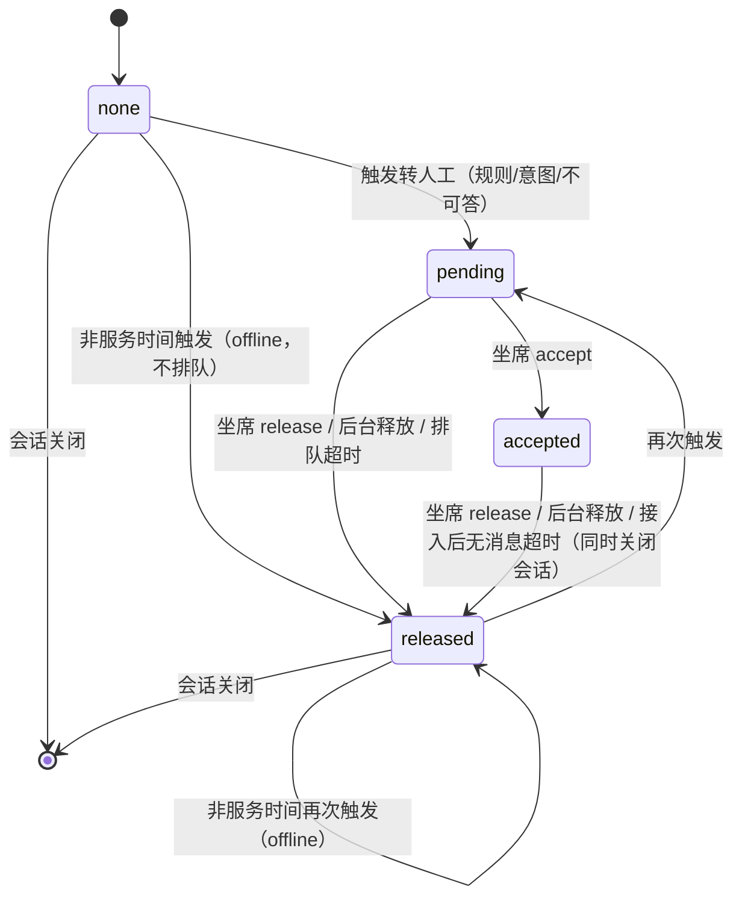

# 会话生命周期与转人工

> 决策记录见 [ADR-0010 会话空闲关闭与会话事件推送](adr/0010-会话空闲关闭与会话事件推送.md)、[ADR-0011 转人工状态机与 Webhook](adr/0011-转人工状态机与Webhook.md)。本文取代 ADR-0008 第 7 条（固定 24 小时关闭、`409 CONVERSATION_CLOSED`、"转人工后 AI 照常回答"）。
> 代码归属：会话状态与空闲关闭在 `aics.modules.chat`（`chat.lifecycle`），会话事件推送在 `chat.events`；转人工状态机与人工坐席接口在新模块 `aics.modules.handoff`；出站 Webhook 在新模块 `aics.modules.webhooks`。它们都通过 `chat.service` 写消息，不直接调用 rag。

## 1. 消息角色与类型
| `messages.role` | 写入方 | `kind` | 说明 |
|---|---|---|---|
| `user` | 终端用户（经接入方） | `chat` | |
| `assistant` | AI | `chat` | 只有它填写 `answer_type`、`intent*`、`citations` 等回答字段 |
| `human_agent` | 人工坐席（经坐席接口） | `chat` | `agent_id` 记录坐席 |
| `system` | 系统 | `idle_notice` / `idle_closed` / `handoff_wait` / `handoff_accepted` / `handoff_released` / `handoff_queue_timeout` / `handoff_offline` / `handoff_idle_closed` | 系统话术；`answer_type` 为 NULL |

- `answer_type` 仍为 `answer` / `refused` / `handoff` / `error`，**只用于 `role=assistant`**；其他角色为 NULL。
- 历史组装（`load_context`）：`user`、`assistant`、`human_agent` 进入历史（human_agent 渲染为 `[人工客服]`）；`system` 消息不进入历史，也不触发压缩计数。
- 空闲计时只看 `user`、`assistant`、`human_agent` 消息：每写入一条，`conversations.last_activity_at = now()`、`idle_notice_sent_at = NULL`；`system` 消息不更新。

## 2. 会话空闲关闭
### 2.1 配置
应用列 `session_config`（jsonb，后台"应用配置 → 会话"分组可编辑）；键为 null 时使用平台默认值（`system_settings.default_session_config`，后台"系统设置"页由 super_admin 编辑）。
| 键 | 平台默认 | 校验 | 说明 |
|---|---|---|---|
| idle_close_minutes | 10 | 1–1440 整数 | 最后一次活动后多少分钟无新消息即关闭会话 |
| idle_notice_before_minutes | 1 | 0 ≤ 值 < idle_close_minutes | 关闭前多少分钟发送提醒；0 = 不提醒；`idle_close_minutes = 1` 时只能为 0 |
| idle_close_notice | "如果没有其他问题，当前服务就结束咯~" | 1–200 字 | 提醒话术 |

保存时校验失败返回 `422 VALIDATION_ERROR`；修改不影响已发出的提醒，下一次扫描按新值判断。

### 2.2 机制（只有一个：beat 扫描）
beat 每 **30 秒**向 `maintenance` 队列投递 `idle_sweep`（调用 `chat.lifecycle.sweep()`），按应用的有效配置分两步处理 `status='active'` 且**不处于暂停状态**（§3.4）的会话：
1. **提醒**：`idle_notice_before_minutes > 0`、`idle_notice_sent_at IS NULL` 且 `last_activity_at ≤ now − (idle_close_minutes − idle_notice_before_minutes)` → 写一条 `role=system, kind=idle_notice` 消息（内容 = `idle_close_notice`），置 `idle_notice_sent_at=now()`，推送会话事件 `conversation.idle_notice`（§4）。
2. **关闭**：`last_activity_at ≤ now − idle_close_minutes` → `status='closed'`、`closed_at=now()`、`close_reason='idle'`，写 `role=system, kind=idle_closed` 消息（内容为空，仅作时间线标记），推送事件 `conversation.closed`。
- 每条更新都带条件 `WHERE status='active' AND last_activity_at = :读到的值`，期间有新消息则不提醒/不关闭（无竞态，任务可重复执行）。
- 精度：提醒与关闭时间误差 ≤ 30 秒。不使用"每条消息重新排程 countdown 任务"的方案（长延迟任务在 RabbitMQ + `acks_late` 下易重复或丢失，且需要处理取消）。
- `channel=eval` 的会话不参与空闲关闭（评测会话运行结束即由评测任务关闭）；`debug` 会话参与（用于验证配置）。

### 2.3 向已关闭会话发消息：自动新建
请求带的 `conversation_id`（或 OpenAI 兼容的 `X-AICS-Conversation-Id`）对应会话已关闭时，**不报错**：`chat.service` 新建一个会话（同 `external_user_id`、`channel`，**不继承**旧会话历史、摘要、事实），在新会话中处理本条消息，响应中返回新 `conversation_id`，并带 `previous_conversation_id`（旧 ID）。客户端应保存新 ID。会话不存在或不属于本应用仍返回 `404 CONVERSATION_NOT_FOUND`。

## 3. 转人工
### 3.1 状态机（`conversations.handoff_status`）

- 状态只有四个；**为什么结束的**记在 `conversations.handoff_end_reason`：`agent`（坐席 release）/ `admin`（后台释放）/ `queue_timeout`（排队超时，§3.6）/ `offline`（非服务时间，§3.7）/ `accepted_idle`（接入后无消息，§3.8）。不另设 `timeout` 状态：超时与离线后会话的行为与 released 完全相同（AI 恢复回答、可再次触发转人工），用原因列区分即可，状态分派表不用增加分支。
- `pending` 不会因空闲关闭而结束：排队超时（默认 5 分钟）先于空闲关闭触发（保存配置时校验 `handoff_queue_timeout_minutes < idle_close_minutes`，见 §3.5）。
- 会话关闭（`status=closed`）后 `handoff_status` 保持最后的值，不再变化。
- 原布尔列 `conversations.handoff` 移除；兼容说明：需要"是否发生过转人工"时用 `handoff_requested_at IS NOT NULL`（后台筛选参数 `handoff=true` 即此含义）；对话响应中的 `handoff` 字段保留，含义不变——**本轮**是否触发转人工。
- 在 `pending` / `accepted` 期间再次命中转人工规则：不重复发 `handoff.requested` 事件、不改状态。

### 3.2 每条 user 消息的处理（由 `chat.service.handle_turn` 按状态分派）
| `handoff_status` | `handoff_ai_mode=continue` | `handoff_ai_mode=wait` |
|---|---|---|
| `none` / `released` | 正常 AI 流程；若本轮触发转人工 → 回复转人工话术（`answer_type=handoff`），状态 → `pending`，发 `handoff.requested` | 同左 |
| `pending` | AI 照常回答（含引用）；user 与 assistant 消息都转发 Webhook（`message.created`） | AI **不回答**；写 `role=system, kind=handoff_wait` 消息（内容 = `handoff_config.wait_text`）作为回复；user 消息转发 Webhook |
| `accepted` | AI 不回答；不自动回复（回复来自坐席）；user 消息转发 Webhook | 同左 |

- 响应字段 `reply_by`：`ai`（本轮由 AI 回答，有 `answer_type`）/ `system`（系统话术，如等待提示，`answer_type=null`）/ `none`（本轮无即时回复，等待坐席，`answer=null`）。
- `pending`（wait）与 `accepted` 期间不调用 rag、不更新 `refusal_streak`、不触发压缩判断以外的 AI 逻辑；消息照常落库并计入历史，坐席释放后 AI 可看到人工对话的上下文。
- 触发转人工时 `refusal_streak` 清零。

### 3.3 坐席侧（入站接口，scope `handoff:write`）
| 动作 | 接口 | 状态要求 | 效果 |
|---|---|---|---|
| 查询 | `GET .../conversations/{id}/handoff` | 任意 | 返回状态、坐席、时间 |
| 接入 | `POST .../conversations/{id}/handoff/accept` `{"agent_id","agent_name"}` | `pending` | → `accepted`；写 `system/handoff_accepted` 消息（`handoff_config.accepted_text`，为空则不写）；推送事件 `handoff.accepted` |
| 回复 | `POST .../conversations/{id}/handoff/messages` `{"agent_id","content"}` | `accepted` 且 `agent_id` 为接入坐席 | 写 `role=human_agent` 消息；推送 `message.created`（SSE 与 Webhook） |
| 结束 | `POST .../conversations/{id}/handoff/release` `{"agent_id","note"}` | `pending` 或 `accepted` | → `released`；写 `system/handoff_released` 消息（`handoff_config.released_text`，为空则不写）；推送 `handoff.released`；之后 AI 恢复回答 |
- 状态不符 → `409 HANDOFF_STATE_CONFLICT`（`details.handoff_status`）；会话已关闭 → `409 CONVERSATION_CLOSED`（坐席接口不自动新建会话）。
- 后台（S,A）保留强制释放：`POST /api/v1/admin/apps/{app_id}/conversations/{id}/handoff/release`（`handoff_end_reason=admin`），写审计；用于坐席平台故障等超时规则覆盖不到的情况。

### 3.4 与空闲关闭的关系
| 状态 | continue | wait |
|---|---|---|
| none / released | 计时 | 计时 |
| pending | 计时（AI 仍在服务） | **暂停**（不提醒、不关闭） |
| accepted | **暂停** | **暂停** |
- 暂停结束（release，含排队超时）时 `last_activity_at = now()` 重新计时。
- 暂停期间由转人工自己的超时兜底，不会无限挂起：wait 模式 `pending` 由排队超时（§3.6）结束；`accepted` 由接入后无消息超时（§3.8）结束。

### 3.5 配置（`handoff_config` 新增键）
| 键 | 默认 | 说明 |
|---|---|---|
| handoff_ai_mode | `continue` | `continue` / `wait`，见 §3.2 |
| wait_text | "已为您转接人工客服，请稍候。" | wait 模式等待话术，1–200 字 |
| accepted_text | null | 坐席接入时发给用户的系统话术，null = 不发 |
| released_text | null | 坐席结束时的系统话术，null = 不发 |
| handoff_queue_timeout_minutes | 5 | 1–120 整数，且 < 有效 `idle_close_minutes`；pending 多久未接入即排队超时（§3.6） |
| queue_timeout_text | "当前客服繁忙，您可以留下问题和联系方式，我们会尽快回复您" | 1–200 字 |
| service_hours | null | 服务时间（§3.7）；null = 7×24 小时 |
| offline_text | "当前为非服务时间，您可以留下问题和联系方式，我们会在服务时间内尽快回复您" | 1–200 字 |
| handoff_accepted_idle_minutes | 30 | 1–1440 整数；accepted 后双方都无消息多久即结束（§3.8） |

校验失败 `422 VALIDATION_ERROR`。这些键都是应用级（`handoff_config`），无平台默认层；新建应用写入上表默认值。

### 3.6 排队超时（pending 未接入）
`idle_sweep` 每轮检查 `handoff_status='pending'` 且 `handoff_requested_at ≤ now − handoff_queue_timeout_minutes` 的 active 会话（两种 AI 模式都适用），条件更新 `WHERE handoff_status='pending' AND handoff_requested_at = :读到的值`（期间被接入则不处理）：
1. `handoff_status → released`，`handoff_end_reason='queue_timeout'`，`handoff_released_at=now()`；
2. 写 `role=system, kind=handoff_queue_timeout` 消息（内容 = `queue_timeout_text`）；
3. 置待回访：`needs_callback=true`、`callback_reason='queue_timeout'`、`callback_requested_at=now()`；
4. 推送事件 `handoff.queue_timeout`（Webhook + 事件流 + 消息历史），并推 `message.created`；
5. `last_activity_at=now()`，会话回到 AI，按空闲规则计时。用户留下的问题与联系方式就是之后的普通 user 消息，管理员在待回访列表中查看会话处理。

### 3.7 服务时间（非服务时间转留言）
`handoff_config.service_hours`（可选）：
```json
{"timezone":"Asia/Shanghai",
 "weekly":{"mon":[["09:00","18:00"]],"tue":[["09:00","18:00"]],"wed":[["09:00","12:00"],["13:30","18:00"]],
           "thu":[["09:00","18:00"]],"fri":[["09:00","18:00"]],"sat":[],"sun":[]}}
```
- `timezone` 为 IANA 名称；每天 0–N 个 `[开始, 结束)` 区间（`HH:MM`，开始 < 结束，不跨零点，同日不重叠）；缺省的星期视为不服务；整个键为 null = 7×24 小时。不做节假日日历（需要时由管理员临时修改配置）。
- 触发转人工时（`none`/`released` 下本轮命中规则）若当前不在服务时间：**不进入 pending**，`handoff_status → released`、`handoff_end_reason='offline'`（`handoff_requested_at` 照常记录），本轮回复为 `role=system, kind=handoff_offline` 消息（内容 = `offline_text`，`reply_by=system`，响应 `handoff=true`），置 `needs_callback=true`、`callback_reason='offline'`，推送 `handoff.offline`；AI 继续服务后续消息。
- 只在触发时判断；已在 pending/accepted 的会话跨过下班时间不受影响（由 §3.6、§3.8 的超时兜底）。

### 3.8 接入后无消息超时（accepted）
`idle_sweep` 检查 `handoff_status='accepted'` 且 `last_activity_at ≤ now − handoff_accepted_idle_minutes` 的会话（user 与 human_agent 消息都更新 `last_activity_at`），条件更新：
1. `handoff_status → released`，`handoff_end_reason='accepted_idle'`；
2. 关闭会话：`status='closed'`、`close_reason='handoff_idle'`，写 `role=system, kind=handoff_idle_closed` 消息（内容为空，时间线标记）；
3. 推送 `handoff.released`（`released_by="system"`、`reason="accepted_idle"`）与 `conversation.closed`（`reason="handoff_idle"`）。不提前提醒、不置待回访。

### 3.9 待回访（needs_callback）
- 列：`needs_callback`、`callback_reason`（`queue_timeout` / `offline`）、`callback_requested_at`、`callback_cleared_at`、`callback_cleared_by`、`callback_note`。同一会话多次触发只保留最近一次原因与时间。
- 后台（S,A）：`GET /api/v1/admin/apps/{app_id}/callbacks`（列表，筛选 `reason`、`from`、`to`，默认只看未处理）；`POST .../conversations/{id}/callback/clear` `{"note"}` 标记已回访，写审计。viewer 只读列表。
- 会话关闭不影响待回访标记。

### 3.10 扫描顺序
`idle_sweep` 每轮依次执行：排队超时（§3.6）→ 接入后无消息超时（§3.8）→ 空闲提醒与关闭（§2.2）。每步都是带条件的单行更新，可重复执行。

## 4. 会话事件推送
同一组事件通过三条通道送达，内容一致（事件格式见[第三方接入指南 §7](../04-api/04-第三方接入指南.md)）：
| 事件 | 触发 |
|---|---|
| `handoff.requested` | 状态 → pending |
| `handoff.accepted` / `handoff.released` | 坐席 accept / release（含后台释放、接入后无消息超时） |
| `handoff.queue_timeout` | 排队超时（§3.6） |
| `handoff.offline` | 非服务时间触发转人工（§3.7） |
| `message.created` | handoff 为 pending/accepted 期间每条新消息（user、assistant、human_agent、system） |
| `conversation.idle_notice` | 空闲提醒 |
| `conversation.closed` | 会话关闭 |

1. **出站 Webhook**（接入方系统 / 坐席平台）：应用 `webhook_config.url`（即需求中的 handoff_webhook_url，承载上表全部事件），HMAC-SHA256 签名，异步投递与重试（§5）。未配置 URL 时不发送（转人工仍按状态机进行，接入方只能通过事件流/轮询感知）。`debug`、`eval` 渠道不发送 Webhook。
2. **会话事件流 SSE**：`GET /api/v1/apps/{app_id}/conversations/{id}/events`（scope `chat`），长连接；服务端通过 Redis pub/sub 频道 `aics:conv:{id}` 推送上表事件（对所有会话都推送 `conversation.*`、`message.created` 中 human_agent/system 消息），15 秒心跳；连接时可带 `Last-Event-ID`（= 消息或事件序号）补发断线期间的消息。用于终端用户端实时收到提醒与人工回复。
3. **轮询**：`GET .../conversations/{id}/messages` 返回全部角色的消息（含 `role`、`kind`），会话对象含 `status`、`handoff_status`。

## 5. 出站 Webhook 投递
- 队列 `context`（低延迟），任务 `deliver_webhook(delivery_id)`；每个事件先写 `webhook_deliveries`（`pending`），再投递。
- 请求：`POST {url}`，`Content-Type: application/json`，超时 5 秒；头 `X-AICS-Event`、`X-AICS-Delivery`（事件 ID）、`X-AICS-Timestamp`（Unix 秒）、`X-AICS-Signature: sha256=<hex(HMAC_SHA256(secret, timestamp + "." + body))>`。
- 成功：2xx。否则重试，间隔 10s、30s、2min、10min、30min（共 6 次尝试），仍失败 → `failed`，后台可手动重发。
- 至少一次投递：接收方按 `id` 去重；每个会话内事件带递增 `seq`，接收方按 `seq` 排序（重试可能乱序）。
- URL 校验与 URL 导入相同（只允许 http/https，默认禁止私网，`AICS_URL_FETCH_ALLOWLIST` 放行），保存配置与每次投递时都校验，禁止跟随重定向。
- 签名密钥：保存配置时由服务端生成（`whsec_` + 32 字节随机），只在生成/轮换时显示一次；库中用 `AICS_DATA_ENCRYPTION_KEY`（Fernet）加密存储（签名需要原文，不能只存哈希）。

## 6. 统计
`app_daily_stats` 增加：`handoff_requested`、`handoff_accepted`、`handoff_released`、`human_agent_messages`、`idle_closed`、`handoff_accept_p50_s`（pending → accepted 耗时中位数）、`handoff_queue_timeout`（排队超时次数）、`handoff_offline`（非服务时间转留言次数）、`handoff_accepted_idle_closed`（接入后无消息结束次数）。待回访不进日统计，由后台待回访列表（§3.9）实时查询，仪表盘显示各应用未处理数。原 `handoff` 列含义改为"`answer_type=handoff` 的 assistant 消息数"。
