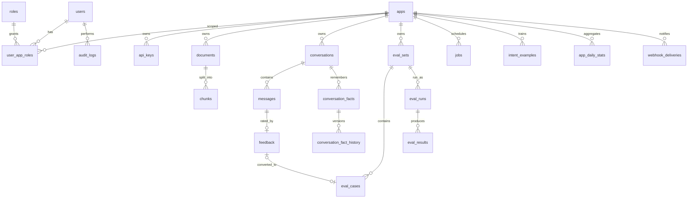

# 数据库设计（PostgreSQL 16，库 `aics`，schema `public`）

## 1. 约定
- 主键 `id uuid`，应用层生成 UUIDv7（时间有序，索引友好）。
- 时间 `timestamptz`，默认 `now()`；所有表有 `created_at`，可变表有 `updated_at`。
- 软删除 `deleted_at timestamptz NULL`；唯一约束用部分索引 `WHERE deleted_at IS NULL`。
- 枚举用 `text + CHECK`（便于迁移），JSON 用 `jsonb`。
- 所有业务表带 `app_id`（除全局表），查询必须带 `app_id` 条件；对应 repository 继承 `AppScopedRepository`（见[模块划分 §5](../02-architecture/02-模块划分.md)）。
- 需要扩展：`pgcrypto`（可选）、无需 pgvector。

## 2. ER 图


## 3. 表结构

### 3.1 users
| 列 | 类型 | 约束 | 说明 |
|---|---|---|---|
| id | uuid | PK | |
| email | text | NOT NULL, 唯一(未删除)，CHECK email = lower(email) | 登录名，小写存储（应用层转小写，库内约束兜底） |
| display_name | text | NOT NULL | |
| password_hash | text | NOT NULL | argon2id |
| is_super_admin | boolean | NOT NULL DEFAULT false | 全局角色 |
| status | text | NOT NULL DEFAULT 'active'，CHECK in (active, disabled) | |
| failed_logins | int | NOT NULL DEFAULT 0 | 锁定计数 |
| locked_until | timestamptz | NULL | |
| last_login_at | timestamptz | NULL | |
| created_at / updated_at / deleted_at | timestamptz | created_at、updated_at NOT NULL DEFAULT now() | |

索引：`uq_users_email_active` UNIQUE(email) WHERE deleted_at IS NULL。迁移 `0001`（M0）。

### 3.2 roles（种子数据，固定 3 行）
| 列 | 类型 | 说明 |
|---|---|---|
| id | text PK | `super_admin` / `app_admin` / `viewer` |
| name | text NOT NULL | 显示名 |
| permissions | jsonb NOT NULL DEFAULT '[]' | 后台 RBAC 权限名列表（点分格式，如 `["app.write","kb.write","key.write","eval.run","log.read"]`），完整清单与角色映射见[安全设计 §2.1](../08-security/01-安全设计.md)；与 API Key scope（`chat`、`kb:read`、`kb:write`，冒号格式）是两套独立命名 |
| created_at | timestamptz NOT NULL DEFAULT now() | 迁移 `0001` 写入 3 行种子数据 |

### 3.3 user_app_roles（应用级授权）
| 列 | 类型 | 约束 |
|---|---|---|
| user_id | uuid | FK users, PK(user_id, app_id) |
| app_id | uuid | FK apps |
| role_id | text | FK roles，CHECK in (app_admin, viewer) |
| created_at | timestamptz | |

> super_admin 由 `users.is_super_admin` 表示，无需逐个授权。
> 本表外键依赖 `apps`，随 M1 的 apps 迁移一起创建（M0 首个迁移只有 users、roles）。迁移 `0002`（M1.2）：`user_id`、`app_id` 外键 `ON DELETE CASCADE`，另建索引 `(app_id)`。

### 3.4 apps
| 列 | 类型 | 约束 | 说明 |
|---|---|---|---|
| id | uuid | PK | 也是 OpenAI 兼容接口的 `model` |
| name | text | NOT NULL | |
| description | text | | |
| status | text | CHECK in (active, disabled, deleting) | disabled 时开放接口返回 `403 APP_DISABLED`；deleting 时开放接口与后台均按不存在处理（`404 APP_NOT_FOUND`），后台仅 S 可在应用列表中看到其清理进度 |
| greeting | text | | 开场白 |
| system_prompt | text | | 角色设定（追加到内置规则后） |
| answer_style | text | DEFAULT 'concise' | concise / detailed / custom |
| fallback_text | text | NOT NULL | 兜底话术 |
| language | text | DEFAULT 'zh-CN' | |
| rag_config | jsonb | NOT NULL | 见下 |
| handoff_config | jsonb | NOT NULL | `{"enabled":true,"keywords":["人工","投诉"],"max_refusals":2,"on_unanswerable":false,"text":"...","handoff_ai_mode":"continue","wait_text":"已为您转接人工客服，请稍候。","accepted_text":null,"released_text":null,"handoff_queue_timeout_minutes":5,"queue_timeout_text":"当前客服繁忙，您可以留下问题和联系方式，我们会尽快回复您","service_hours":null,"offline_text":"当前为非服务时间，您可以留下问题和联系方式，我们会在服务时间内尽快回复您","handoff_accepted_idle_minutes":30}`，新键含义见[会话生命周期与转人工](../02-architecture/09-会话生命周期与转人工.md) §3.5 |
| session_config | jsonb | NOT NULL DEFAULT '{}' | `{"idle_close_minutes":null,"idle_notice_before_minutes":null,"idle_close_notice":null}`，null = 取平台默认（`system_settings.default_session_config`），见[会话生命周期与转人工](../02-architecture/09-会话生命周期与转人工.md) §2.1 |
| webhook_config | jsonb | NOT NULL DEFAULT '{}' | `{"url":null,"secret_enc":null,"secret_prefix":null}`；`secret_enc` 为 Fernet（`AICS_DATA_ENCRYPTION_KEY`）加密的签名密钥，接口只返回 `secret_prefix` |
| chunk_config | jsonb | NOT NULL | `{"preset":"general","strategy":"heading","chunk_size":500,"chunk_overlap":80,"separators":[],"split_by_heading":true,"keep_tables":true,"mode":"general","parent_mode":"paragraph","parent_size":1024,"full_doc_max_tokens":10000,"child_size":200,"child_overlap":20,"child_separators":[],"normalize_whitespace":true,"remove_urls_emails":false,"contextual_prefix":true}`，字段与预设见[文档处理流水线 §3.3](../02-architecture/04-文档处理流水线.md) |
| custom_dict | text[] | DEFAULT '{}' | jieba 自定义词；变化时触发 `retokenize_app`（重算 chunks 与 messages 的 `search_text`） |
| config_version | int | DEFAULT 1 | 任何配置修改 +1，写入消息便于追溯 |
| chunk_config_version | int | DEFAULT 1 | `chunk_config` 变化 +1；文档的 `chunk_config_version` 小于此值即需重建 |
| created_by | uuid | FK users | |
| created_at / updated_at / deleted_at | timestamptz | | |

`rag_config` 默认值（M2.2b 起含 `retrieval_mode`、`fusion`、`vector_weight`、`vector_score_threshold`、`default_tags`，见 RAG 流程设计 §4.2；`fusion` 默认 `weighted` 见 ADR-0015）：
```json
{"vector_top_k":20,"keyword_top_k":20,"fuse_top_k":30,"rerank_top_n":5,"enable_rerank":true,
 "retrieval_mode":"hybrid","fusion":"weighted","vector_weight":0.7,"vector_score_threshold":null,"default_tags":[],
 "rerank_threshold":0.5,"judge_with_llm":true,"judge_gray_upper":0.8,
 "history_token_budget":3000,"compact_trigger_tokens":6000,"keep_recent_turns":4,
 "enable_facts":true,"enable_history_recall":false,"summary_model":null,"openai_temp_summary":true,
 "temperature":0.2,"max_tokens":800,"llm_model":null,
 "intent":{"enabled":true,"enabled_intents":["kb_qa","chitchat","human","out_of_scope","action","clarify"],
   "chitchat_keywords":["你好","您好","在吗","谢谢","好的","再见"],"chitchat_replies":null,"chitchat_max_chars":20,
   "sensitive_keywords":[],"sensitive_reply":"抱歉，这个问题我无法回答。","out_of_scope_reply":null,
   "action_reply":"这个需要人工客服帮您办理，正在为您转接。","min_confidence":0.6,"clarify_threshold":0.7,
   "classify_timeout_ms":2000,"vector_fast_path":false,"vector_threshold":0.9}}
```
> 取值范围（保存时校验，失败 `422 VALIDATION_ERROR`）：`vector_top_k` / `keyword_top_k` 1–100，`fuse_top_k` 1–200，`rerank_top_n` 1–20，`rerank_threshold` ≤ `judge_gray_upper`（均 0–1），`temperature` 0–2，`max_tokens` 64–8192；`chunk_config.chunk_size` 100–2000，`0 ≤ chunk_overlap ≤ chunk_size / 2`；`handoff_config.keywords` ≤ 200 个、每个 ≤ 20 字，`max_refusals` 1–10。
>
> 结构由 `aics/rag/config.py` 的 `AppRagConfig` 唯一定义，读出时校验并补齐默认值；`llm_model` / `summary_model` 为 null 表示使用 `AICS_LLM_MODEL`，非 null 时必须是 `AICS_MODELS` 中 `kind=chat` 的模型。上下文相关键的含义与校验见[对话上下文管理 §9](../02-architecture/07-对话上下文管理.md)；`intent` 对象见[意图识别 §7](../02-architecture/08-意图识别.md)（转人工关键词仍在 `handoff_config.keywords`）。

### 3.5 api_keys
| 列 | 类型 | 约束 | 说明 |
|---|---|---|---|
| id | uuid | PK | |
| app_id | uuid | FK apps NOT NULL | |
| name | text | NOT NULL | |
| prefix | text | NOT NULL, UNIQUE | 明文前 12 位 `aics_xxxxxxx`，用于查找和展示 |
| key_hash | text | NOT NULL | HMAC-SHA256(pepper, 完整 key) 十六进制 |
| scopes | text[] | NOT NULL | `chat`、`kb:read`、`kb:write`、`handoff:write` |
| rpm_limit | int | DEFAULT 60 | 每分钟请求 |
| daily_quota | int | NULL | 每日请求上限，NULL 不限 |
| ip_allowlist | cidr[] | NULL | P1 |
| expires_at | timestamptz | NULL | |
| revoked_at | timestamptz | NULL | |
| last_used_at | timestamptz | NULL | 异步更新（Redis 聚合，每分钟落库） |
| created_by | uuid | FK users | |
| created_at | timestamptz | | |

索引：`(app_id)`。

### 3.6 documents
| 列 | 类型 | 约束 | 说明 |
|---|---|---|---|
| id | uuid | PK | |
| app_id | uuid | FK apps NOT NULL | |
| title | text | NOT NULL | 默认文件名 |
| source_type | text | CHECK in (file, url) | |
| source_uri | text | | 原文件名或 URL |
| mime_type | text | | |
| size_bytes | bigint | | |
| content_hash | char(64) | NOT NULL | SHA-256 |
| storage_key | text | | 生效版本文件 `{app_id}/{id}/v{version}.pdf` |
| version | int | NOT NULL DEFAULT 1 | 文件版本，替换（FR-KB-08）+1 |
| status | text | CHECK in (queued, parsing, indexing, done, failed, deleting) | 最近一次构建状态；状态机见[文档处理流水线 §1](../02-architecture/04-文档处理流水线.md) |
| progress | smallint | 0–100 | |
| error | text | NULL | 失败原因（用户可读） |
| chunk_count | int | DEFAULT 0 | |
| index_version | int | NOT NULL DEFAULT 0 | 当前生效构建号（0 = 无可用版本）；只有 `chunks.index_version` 等于此值的切块参与检索 |
| pending_index_version | int | NULL | 正在构建的构建号 |
| chunk_config_version | int | NULL | 生效版本使用的 `apps.chunk_config_version` |
| embed_model | text | | 生效版本的向量模型 |
| indexed_title | text | NULL | 生效版本向量化时使用的标题（上下文增强前缀），迁移 `0004`（M1.4） |
| chunk_config | jsonb | NULL | 文档级切块配置覆盖（M1.7，迁移 `0005`）：保存时与应用 `chunk_config` 合并（含 `preset` 则以预设为底）并经 `ChunkConfig` 与上下文窗口规则校验后的**完整快照**；NULL = 跟随应用。应用 `chunk_config` 变化不影响有覆盖的文档；新值随该文档的构建成功切换时写入（见文档处理流水线 §3.5） |
| tags | text[] | NOT NULL DEFAULT '{}' | 元数据标签，过滤检索用（迁移 `0008`，M2.2b）；GIN 索引 `ix_documents_tags`；镜像到 Qdrant payload `tags`；每文档 ≤ 20 个、每个 ≤ 50 字 |
| effective_at / expires_at | timestamptz | NULL | 有效期，期外不参与检索（规划 M4.3b） |
| metadata | jsonb | DEFAULT '{}' | 接入方自定义（如分类） |
| created_by | uuid | NULL | 后台用户；API Key 上传为 NULL |
| created_at / updated_at / deleted_at | timestamptz | | |

索引：唯一 `(app_id, content_hash) WHERE deleted_at IS NULL`；`(app_id, status)`；`(app_id, created_at DESC)`。

### 3.7 chunks
| 列 | 类型 | 约束 | 说明 |
|---|---|---|---|
| id | uuid | PK | = Qdrant point id |
| app_id | uuid | NOT NULL | 冗余，便于过滤 |
| document_id | uuid | FK documents ON DELETE CASCADE | |
| index_version | int | NOT NULL | 所属构建号（= 构建时的 `documents.pending_index_version`） |
| ordinal | int | NOT NULL | 文档内序号 |
| parent_id | uuid | NULL，FK chunk_parents ON DELETE CASCADE | 父子模式下所属父块；通用模式为 NULL |
| heading_path | text | | `A > B > C` |
| text | text | NOT NULL | 正文 |
| search_text | text | NOT NULL | jieba 分词后空格连接 |
| tsv | tsvector | GENERATED ALWAYS AS (to_tsvector('simple', search_text)) STORED | |
| tokens | int | | |
| page_from / page_to | int | NULL | PDF 页码 |
| enabled | boolean | DEFAULT true | 管理员禁用（FR-KB-09）或文档删除时为 false |
| review_status | text | CHECK in (none, flagged, approved) DEFAULT 'none' | 入库注入检测命中为 flagged；管理员复核通过为 approved |
| flag_reason | text | NULL | 命中的注入短语 |
| reviewed_by / reviewed_at | uuid / timestamptz | NULL | 复核人与时间 |
| created_at | timestamptz | | |

**可检索条件**（唯一定义）：`enabled AND review_status <> 'flagged' AND chunks.index_version = documents.index_version AND documents.status <> 'deleting'`。Qdrant payload `enabled` 镜像 `enabled AND review_status <> 'flagged'`；版本条件在向量命中回 PG 取正文时过滤。

索引：`GIN(tsv)`；`(document_id, index_version, ordinal)` 唯一；`(app_id) WHERE enabled`；`(app_id, review_status) WHERE review_status = 'flagged'`。
> `vector id` 即 `id`，不再单独存列；向量模型记在 documents.embed_model。

> 规划（设计讨论 0001）：`chunks.source text DEFAULT 'parsed'`（`parsed` / `manual`，M4.3b）；可检索条件追加 `documents` 在有效期内（M4.3b）；请求带标签时追加 `documents.tags && :tags`（M2.2b 已实现）。

### 3.7.2 chunk_questions（切块补充问题，迁移 `0008`，M2.2b）
| 列 | 类型 | 约束 | 说明 |
|---|---|---|---|
| id | uuid | PK | = Qdrant 点 id（payload `kind=question`） |
| app_id | uuid | NOT NULL | |
| document_id | uuid | FK documents ON DELETE CASCADE | 文档删除时一并删除 |
| chunk_id | uuid | NULL，FK chunks **ON DELETE SET NULL** | 所答切块；`pending` 时为 NULL（设计讨论 0003 C2：清理旧构建不能静默删掉运营录入） |
| question | text | NOT NULL，CHECK 1–200 字 | |
| status | text | CHECK in (active, pending) DEFAULT 'active' | 重建后匹配不到新切块 → pending |
| source | text | CHECK in (manual, llm) DEFAULT 'manual' | `llm` 目前只用于评测 |
| anchor_ordinal / anchor_hash | int / char(64) | NOT NULL | 挂接时切块的 ordinal 与 sha256(正文)，重建迁移用 |
| created_by / created_at | uuid / timestamptz | | |

索引：`(chunk_id)`、`(app_id, document_id)`。每条单独向量化（不加标题前缀）。重建文档时按正文哈希相同、ordinal 最近迁移到新构建号的切块（只改 Qdrant payload），迁移不上的转 `pending` 并删点，可由后台重新挂接；迁移幂等，构建切换后与清理旧构建前各执行一次。每块最多 20 条（服务层校验）。

### 3.7.3 chunk_stats（切块质量统计，规划 M4.6b）
`chunk_id uuid PK, app_id uuid NOT NULL, recall_count int, cite_count int, thumbs_up int, thumbs_down int, last_recalled_at timestamptz, updated_at`；由 `aggregate_daily_stats` 从 messages 的检索 trace 与 feedback 聚合；后台列出"长期未召回""差评集中"的切块。

### 3.7.1 chunk_parents（父块，迁移 `0003`，M1.3b）
| 列 | 类型 | 约束 | 说明 |
|---|---|---|---|
| id | uuid | PK | |
| app_id | uuid | NOT NULL | 冗余，repository 按应用隔离 |
| document_id | uuid | FK documents ON DELETE CASCADE | |
| index_version | int | NOT NULL | 与其子块相同的构建号 |
| ordinal | int | NOT NULL | 文档内父块序号；唯一 `(document_id, index_version, ordinal)` |
| heading_path / text / tokens | text / text / int | text、tokens NOT NULL | 送入 LLM 的正文 |
| page_from / page_to | int | NULL | |
| created_at | timestamptz | | |

- 只在 `chunk_config.mode = parent_child` 时写入；父块不向量化、不建全文索引，可检索条件仍只看子块（§3.7）。
- `chunks.parent_id` 部分索引 `ix_chunks_parent_id WHERE parent_id IS NOT NULL`；删除父块级联删除子块；`cleanup_document` 按构建号同时清理两表。
- 选用独立表而非在 chunks 中混存父块：chunks 的每一行都是可检索单元，可检索条件、全文索引与 Qdrant 点一一对应，不需要额外的"类型"过滤。

### 3.8 conversations
| 列 | 类型 | 说明 |
|---|---|---|
| id | uuid PK | |
| app_id | uuid NOT NULL | |
| channel | text CHECK in (api, openai, debug, eval) | 来源；`debug`（后台调试）与 `eval`（评测运行）不计入统计、默认不出现在会话日志（可按渠道筛选） |
| status | text CHECK in (active, closed) DEFAULT 'active' | 空闲关闭规则见[会话生命周期与转人工](../02-architecture/09-会话生命周期与转人工.md) §2；向已关闭会话发消息会自动新建会话 |
| closed_at | timestamptz NULL | |
| close_reason | text NULL CHECK in (idle, handoff_idle, app_deleted, eval_done) | `handoff_idle` = 人工接入后双方无消息超时 |
| previous_conversation_id | uuid NULL | 因旧会话已关闭而自动新建时指向旧会话 |
| last_activity_at | timestamptz NOT NULL DEFAULT now() | 最后一条 user / assistant / human_agent 消息时间（system 消息不更新），空闲计时依据 |
| idle_notice_sent_at | timestamptz NULL | 本轮空闲已发提醒的时间；有新活动时置 NULL |
| external_user_id | text NULL | 接入方传的 user_id |
| api_key_id | uuid NULL | |
| created_by | uuid NULL | debug 时为后台用户 |
| title | text | 首个问题前 50 字 |
| message_count | int DEFAULT 0 | |
| refusal_streak | int DEFAULT 0 | 连续拒答次数（转人工规则用） |
| handoff_status | text CHECK in (none, pending, accepted, released) DEFAULT 'none' | 转人工状态机，取代原布尔列 `handoff`（"是否发生过转人工" = `handoff_requested_at IS NOT NULL`） |
| handoff_reason | text NULL | 最近一次转人工原因（`keyword` / `max_refusals` / `unanswerable` / `intent_human` / `intent_action`） |
| handoff_requested_at / handoff_accepted_at / handoff_released_at | timestamptz NULL | 最近一次各状态变更时间 |
| handoff_end_reason | text NULL CHECK in (agent, admin, queue_timeout, offline, accepted_idle) | 最近一次进入 released 的原因 |
| needs_callback | boolean DEFAULT false | 待回访（排队超时或非服务时间转人工） |
| callback_reason | text NULL CHECK in (queue_timeout, offline) | |
| callback_requested_at / callback_cleared_at | timestamptz NULL | |
| callback_cleared_by | uuid NULL FK users | |
| callback_note | text NULL | 回访备注 |
| handoff_agent_id / handoff_agent_name | text NULL | 接入坐席（坐席平台的 ID，非 AICS 用户） |
| event_seq | bigint DEFAULT 0 | 会话事件序号（Webhook `seq`、事件流 `Last-Event-ID`） |
| summary | jsonb NULL | 结构化滚动摘要 `{user_goal, confirmed_info[], solutions_given[], open_issues[]}` |
| summary_until_msg_id | uuid NULL | 摘要覆盖到的最后一条消息 |
| summary_version | int DEFAULT 0 | 每次压缩成功 +1（乐观锁） |
| summary_updated_at | timestamptz NULL | |
| metadata | jsonb | 含 `summary_history`（最近 5 版摘要） |
| last_message_at | timestamptz | |
| created_at | timestamptz | |

索引：`(app_id, last_message_at DESC)`；`(app_id, external_user_id)`；`(last_activity_at) WHERE status = 'active'`（`idle_sweep` 用）；`(app_id, handoff_status) WHERE handoff_status IN ('pending','accepted')`；`(app_id, callback_requested_at DESC) WHERE needs_callback`（待回访列表）。
> 空闲判定只由 beat 任务 `idle_sweep`（每 30 秒）执行，见[会话生命周期与转人工](../02-architecture/09-会话生命周期与转人工.md) §2.2。
> **实现补充（M2.1，迁移 `0006`）**：`app_id` 外键 `apps.id`（与 documents 一致，应用删除走 `cleanup_app`）；`previous_conversation_id` 自引用外键 `ON DELETE SET NULL`；`created_by` / `callback_cleared_by` 外键 `users`；`last_message_at`、`last_activity_at` NOT NULL DEFAULT now()（新会话按创建时间参与排序与空闲计时）；`message_count` 计所有角色消息（含 system），`title` 为首条 user 消息 strip 后前 50 字；增加 CHECK `(status = 'closed') = (closed_at IS NOT NULL)` 与计数非负。写入只经 `chat.repository`（`ConversationRepository` / `MessageRepository.append`）。

### 3.9 messages
| 列 | 类型 | 说明 |
|---|---|---|
| id | uuid PK | |
| conversation_id | uuid FK | |
| app_id | uuid NOT NULL | |
| role | text CHECK in (user, assistant, human_agent, system) | 见[会话生命周期与转人工](../02-architecture/09-会话生命周期与转人工.md) §1 |
| kind | text NOT NULL DEFAULT 'chat' CHECK in (chat, idle_notice, idle_closed, handoff_wait, handoff_accepted, handoff_released, handoff_queue_timeout, handoff_offline, handoff_idle_closed) | `system` 消息的类型；其他角色为 `chat` |
| agent_id | text NULL | `human_agent` 消息的坐席 ID |
| content | text | |
| token_count | int DEFAULT 0 | 入库时用 `core.tokens.count_tokens` 计算，用于上下文预算 |
| search_text | text NOT NULL DEFAULT '' | 该应用 jieba 分词结果，用于会话内回查 |
| tsv | tsvector | GENERATED ALWAYS AS (to_tsvector('simple', search_text)) STORED |
| answer_type | text CHECK in (answer, refused, handoff, error) NULL | 仅 assistant；`error` = 生成过程出错（content 为空或部分内容，`decision_reason` 记错误码），与接口定义一致 |
| intent | text NULL CHECK in (kb_qa, chitchat, human, out_of_scope, action, clarify, blocked) | 仅 assistant，对应 user 问题的最终意图；历史消息为 NULL |
| intent_confidence | real NULL CHECK 0–1 | |
| intent_source | text NULL CHECK in (rule, vector, llm, fallback) | 判定层 |
| slots | jsonb NULL | LLM 抽取的槽位（可能含个人信息，日志脱敏） |
| rewritten_query | text NULL | |
| citations | jsonb | `[{"n":1,"chunk_id","document_id","document_title","heading_path","snippet","score","page"}]`，与开放接口 citation 对象字段完全一致；`page` 为切块起始页（无页码为 null），`document_title` 为回答时的标题快照 |
| retrieval_trace | jsonb NULL | 各路命中与分数（调试用，保留 30 天后置空） |
| decision_reason | text NULL | |
| handoff | boolean DEFAULT false | 仅 assistant：本轮是否触发转人工 |
| degraded | text[] | |
| prompt_tokens / completion_tokens | int | |
| latency_ms / first_token_ms | int | |
| llm_model | text | |
| prompt_version | text NULL | 本轮使用的提示词版本串（如 `cc3.gen5.judge2`），见[RAG 流程设计 §5](../02-architecture/03-RAG流程设计.md) |
| config_version | int | |
| interrupted | boolean DEFAULT false | |
| created_at | timestamptz | |

索引：`(conversation_id, created_at)`；`(app_id, created_at DESC)`；`(app_id, answer_type)`；`(app_id, intent, created_at DESC)`；`GIN(tsv)`。
> `answer_type`、`intent*`、`citations` 等回答字段只对 `role=assistant` 有值，其他角色为 NULL。
> 写入顺序：user 消息在调用 rag 之前写入；assistant 消息在生成完成（或中断、出错）后写入，均由 `chat.service` 完成。
> 意图兜底原因、原始意图等调参细节存 `retrieval_trace.intent`，见[意图识别 §9](../02-architecture/08-意图识别.md)。
> 量大后按月分区（v2），v1 用保留策略：消息默认保留 180 天（可配）。
> **实现补充（M2.1）**：`conversation_id` 外键 `ON DELETE CASCADE`（删除会话即删除消息，与 facts 一致）；`created_at` 默认 `clock_timestamp()` 而非 `now()`，同一事务内写入的 user / assistant 消息时间也严格递增，消息顺序统一按 `(created_at, id)`；增加 CHECK：非 system 消息 `kind = 'chat'`、回答字段（`answer_type`、`intent*`、`citations`、`handoff`）只允许 assistant、`token_count >= 0`；`degraded` NOT NULL DEFAULT '{}'。`token_count`（`core.tokens`）与 `search_text`（应用 jieba 分词器 + `custom_dict`）只由 `MessageRepository.append` 计算，输入模型 `NewMessage` 不接受这两个字段；**system 消息 `search_text` 为空**（平台提示语不是对话内容，不参与回查）。消息落库后只允许改 `retrieval_trace`（保留期清理）。单条内容存储上限 `MESSAGE_CONTENT_MAX_CHARS`=20000 字符（见参数默认值与依据）。

### 3.9.1 conversation_facts（会话关键事实，M2.1；设计讨论 0002）
| 列 | 类型 | 说明 |
|---|---|---|
| id | uuid PK | |
| conversation_id | uuid FK conversations ON DELETE CASCADE | |
| app_id | uuid NOT NULL | |
| key | text NOT NULL | 白名单键：`order_no`、`product`、`issue_type`、`phone`、`address_region`、`solution_given`、`user_emotion`、`other:<英文名>` |
| value | text NOT NULL | 可能含个人信息，日志脱敏 |
| source_message_id | uuid NULL | 来源消息 |
| confidence | real CHECK 0–1 | |
| category | text NOT NULL | 由 key 推导：order / identity / product / issue / resolution / emotion / other |
| importance | smallint CHECK 1–3 | 3 = order_no、phone；2 = product、issue_type；1 = 其余 |
| source | text CHECK in (slot, compaction) | 最近一次写入来源 |
| version | int DEFAULT 1 | 每次更新 / 撤回 +1 |
| first_seen_at | timestamptz | |
| retracted_at | timestamptz NULL | 用户否认后撤回（不删除） |
| created_at / updated_at | timestamptz | |

约束：`UNIQUE(conversation_id, key)`；按对账规则 ADD / UPDATE / NOOP / RETRACT 写入，不删除（随会话级联删除）；索引 `(app_id, conversation_id)`。详见[对话上下文管理 §5.3](../02-architecture/07-对话上下文管理.md)。

### 3.9.2 conversation_fact_history（事实版本历史，M2.1，追加写）
| 列 | 类型 | 说明 |
|---|---|---|
| id | uuid PK | |
| fact_id | uuid FK conversation_facts ON DELETE CASCADE | |
| app_id / conversation_id | uuid NOT NULL | |
| key | text NOT NULL | |
| op | text CHECK in (add, update, retract) | |
| old_value / new_value | text NULL | 日志脱敏 |
| old_source_message_id / new_source_message_id | uuid NULL | |
| source | text CHECK in (slot, compaction) | |
| confidence | real | |
| changed_at | timestamptz DEFAULT now() | |

索引：`(app_id, conversation_id, changed_at)`；只 INSERT。

> **实现补充（M2.1，迁移 `0007`）**：facts 的 `key` 用 CHECK 正则约束白名单（`other:` 后缀 `[a-z_]{1,32}`），`value` 非空，`confidence` NOT NULL；`category` / `importance` 只由 `aics.memory.schemas.fact_category / fact_importance` 从 key 推导。history 的 `changed_at` 默认 `clock_timestamp()`；CHECK 约束各操作的取值形状（add：old 空 new 非空；update：两者非空；retract：new 空）；**追加写在两层保证**：repository 只有 `append`（update / delete 抛 `TypeError`），数据库 `BEFORE UPDATE` 触发器 `trg_conversation_fact_history_no_update` 拒绝任何 UPDATE（参考审计表的常见做法；DELETE 仍允许，以便会话级联删除与保留期清理）。

### 3.10 feedback
| 列 | 类型 | 说明 |
|---|---|---|
| id | uuid PK | |
| app_id | uuid | |
| message_id | uuid FK UNIQUE | 每条回答一个反馈（可覆盖） |
| rating | smallint CHECK in (1, -1) | |
| comment | text | |
| source | text CHECK in (api, admin) | |
| handled | boolean DEFAULT false | 管理员已处理 |
| eval_case_id | uuid NULL FK eval_cases ON DELETE SET NULL | 已转为评测用例时指向该用例 |
| created_at / updated_at | timestamptz | |

### 3.11 eval_sets / eval_cases / eval_runs / eval_results
**eval_sets**：`id, app_id, name, description, case_count, created_by, created_at, updated_at, deleted_at`。

**eval_cases**：`id, eval_set_id, question, expected_answer text NULL, expected_document_ids uuid[] DEFAULT '{}'（文档 ID；替换文档 ID 不变，因此用例长期有效）, should_refuse boolean DEFAULT false, expected_intent text NULL（取值同 messages.intent，空 = 不评测意图）, history jsonb NULL（多轮用例）, tags text[], source text CHECK in (manual, csv, feedback, debug), source_feedback_id uuid NULL, created_at`。

**eval_runs**：`id, eval_set_id, app_id, status CHECK in (queued, running, done, failed), config_snapshot jsonb, prompt_versions jsonb（`{name: version}`）, llm_model text, metrics jsonb（见评测指南）, case_total int, case_done int, error text, started_at, finished_at, created_by, created_at`。

**eval_results**：`id, eval_run_id, eval_case_id, answer text, answer_type text, citations jsonb, retrieved_document_ids uuid[], hit_at_5 boolean, citation_hit boolean, correct boolean NULL, faithful boolean NULL, refuse_ok boolean NULL, intent text NULL, intent_ok boolean NULL, judge_reason text, conversation_id uuid NULL（评测会话，`channel=eval`）, prompt_version text, trace jsonb, latency_ms int, tokens int`。`answer_type` 取值同 `messages.answer_type`。索引 `(eval_run_id)`。

### 3.11.1 intent_examples（意图示例句，M5+，仅开启向量快速通道时创建）
`id uuid PK（= Qdrant point id）, app_id uuid FK apps NOT NULL, intent text CHECK in (chitchat, human, out_of_scope, action), text text NOT NULL（≤ 200 字）, source text CHECK in (manual, log), embed_model text, created_by uuid NULL, created_at, deleted_at`。唯一 `(app_id, intent, text) WHERE deleted_at IS NULL`。向量存 Qdrant `aics_intents__{embed_model}__{dim}`，详见[意图识别 §5.3](../02-architecture/08-意图识别.md)。

### 3.12 jobs（后台任务记录）
`id, app_id NULL（FK apps ON DELETE CASCADE；NULL = 平台级任务如 reindex_all）, type CHECK in (ingest, replace, reindex_document, reindex_app, reindex_all, retokenize_app, cleanup_document, cleanup_app, compact, reconcile, eval), target_id uuid, status CHECK in (queued, running, done, failed, cancelled), progress smallint, payload jsonb, error text, celery_task_id text, created_by, created_at, started_at, finished_at`。索引 `(app_id, created_at DESC)`、`(status)`。

| type | Celery 任务 | 队列 | 触发 |
|---|---|---|---|
| ingest | `ingest_document` | ingest | 上传 / URL 导入 |
| replace | `ingest_document`（payload 含新文件） | ingest | 替换文档 |
| reindex_document | `ingest_document` | ingest | 单文档重建 |
| reindex_app | `reindex_app` | ingest | 切块配置变化后重建 |
| reindex_all | `reindex_all` | ingest | 平台向量模型变化 |
| retokenize_app | `retokenize_app` | ingest | `custom_dict` 变化 |
| cleanup_document | `cleanup_document` | maintenance | 删除文档、清理旧构建版本 |
| cleanup_app | `cleanup_app` | maintenance | 删除应用 |
| compact | `compact_conversation` | context | 仅调试会话"立即压缩"（自动压缩不写 jobs） |
| reconcile | `reconcile` | maintenance | 手动对账（每日定时对账不写 jobs） |
| eval | `run_eval` | eval | 评测运行 |

`cancelled`：任务发现应用或文档处于 `deleting` 而中止。不写 jobs 的任务：自动压缩、`embed_message`、beat 定时任务（只记日志与指标）。

### 3.12.1 app_daily_stats（每日统计）
| 列 | 类型 | 说明 |
|---|---|---|
| app_id | uuid | PK(app_id, date)，FK apps |
| date | date | 按 Asia/Shanghai 自然日 |
| conversations | int | 当日新建会话数 |
| messages | int | 当日 user 消息数（= 轮数） |
| answered / refused / handoff / errors | int | assistant 消息按 `answer_type` 计数（`handoff` = `answer_type=handoff` 的消息数） |
| handoff_requested / handoff_accepted / handoff_released | int | 当日转人工状态变更次数 |
| handoff_accept_p50_s | int NULL | pending → accepted 耗时中位数（秒） |
| handoff_queue_timeout / handoff_offline / handoff_accepted_idle_closed | int | 当日排队超时、非服务时间转留言、接入后无消息结束的次数 |
| human_agent_messages | int | 当日人工坐席消息数 |
| idle_closed | int | 当日因空闲关闭的会话数 |
| negative_feedback | int | 当日点踩数 |
| intent_distribution | jsonb | `{"kb_qa": 120, "chitchat": 30, ...}` |
| tokens_in / tokens_out | bigint | `prompt_tokens` / `completion_tokens` 合计 |
| latency_p50_ms / latency_p95_ms | int | assistant 消息 `latency_ms` 分位数 |
| first_token_p95_ms | int | 流式首 token P95 |
| updated_at | timestamptz | |

- 只统计 `channel IN ('api','openai')`，`debug`、`eval` 渠道排除。
- 由 beat 任务 `aggregate_daily_stats`（队列 `maintenance`，调用 `stats.service`）每小时重算当天、00:30 定稿前一天，`INSERT ... ON CONFLICT (app_id, date) DO UPDATE`，幂等。
- 仪表盘与 `/stats` 接口只读此表，不实时扫描 messages；分位数只按日给出，区间汇总接口返回按日序列与计数合计。

### 3.13 audit_logs
| 列 | 类型 | 说明 |
|---|---|---|
| id | bigint IDENTITY PK | 只追加，用自增更省 |
| actor_type | text CHECK in (user, api_key, system) | |
| actor_id | uuid NULL | |
| app_id | uuid NULL | |
| action | text | 如 `app.update`、`kb.document.delete`、`key.revoke` |
| target_type / target_id | text / uuid | |
| diff | jsonb | `{"before":{},"after":{}}`（敏感字段脱敏） |
| ip | inet | |
| user_agent | text | |
| request_id | text | |
| created_at | timestamptz | |

索引：`(app_id, created_at DESC)`、`(actor_id, created_at DESC)`。应用层不提供修改/删除审计日志的接口；拆分 `aics_app` 账号后（见迁移策略），对此表只授予 INSERT/SELECT。

### 3.14 system_settings（平台设置）
`key text PK, value jsonb NOT NULL, updated_by uuid, updated_at timestamptz`。v1 只有一个键 `default_session_config`，初始值 `{"idle_close_minutes":10,"idle_notice_before_minutes":1,"idle_close_notice":"如果没有其他问题，当前服务就结束咯~"}`（种子数据随迁移写入）；后台"系统设置"页由 super_admin 修改，写审计。
> **实现补充（M2.1）**：`updated_by` 外键 `users`；读取经 `apps.system_settings.SystemSettingsService`（存储值缺失或校验失败时回落代码默认 `PLATFORM_DEFAULT_SESSION` 并记 warning，保证对话可用）；写入只接受白名单键并用 `EffectiveSessionConfig` 校验（非法 → `422 VALIDATION_ERROR`）；`AppService.load(session)` 用存储的平台默认合并应用 `session_config`。

### 3.15 webhook_deliveries（出站 Webhook 投递记录）
| 列 | 类型 | 说明 |
|---|---|---|
| id | uuid PK | = 事件 ID（payload `id`、`X-AICS-Delivery`） |
| app_id | uuid NOT NULL | |
| conversation_id | uuid NULL | |
| event | text | `handoff.requested` 等，见[第三方接入指南 §7](../04-api/04-第三方接入指南.md) |
| seq | bigint | 会话内事件序号 |
| payload | jsonb | 发送的完整 JSON |
| status | text CHECK in (pending, delivered, failed) | |
| attempts | smallint DEFAULT 0 | |
| last_status_code | int NULL / last_error text NULL | |
| next_attempt_at / delivered_at | timestamptz NULL | |
| created_at | timestamptz | |

索引：`(app_id, created_at DESC)`、`(status, next_attempt_at)`。保留 30 天（`purge_expired` 清理）。

## 4. DDL 示意（节选，正式以 Alembic 为准）
```sql
CREATE TABLE apps (
  id uuid PRIMARY KEY,
  name text NOT NULL,
  description text,
  status text NOT NULL DEFAULT 'active' CHECK (status IN ('active','disabled','deleting')),
  greeting text, system_prompt text,
  answer_style text NOT NULL DEFAULT 'concise' CHECK (answer_style IN ('concise','detailed','custom')),
  fallback_text text NOT NULL DEFAULT '抱歉，这个问题我暂时无法回答，建议联系人工客服。',
  language text NOT NULL DEFAULT 'zh-CN',
  rag_config jsonb NOT NULL, handoff_config jsonb NOT NULL, chunk_config jsonb NOT NULL,
  session_config jsonb NOT NULL DEFAULT '{}', webhook_config jsonb NOT NULL DEFAULT '{}',
  custom_dict text[] NOT NULL DEFAULT '{}',
  config_version int NOT NULL DEFAULT 1, chunk_config_version int NOT NULL DEFAULT 1,
  created_by uuid REFERENCES users(id),
  created_at timestamptz NOT NULL DEFAULT now(),
  updated_at timestamptz NOT NULL DEFAULT now(),
  deleted_at timestamptz
);

CREATE TABLE documents (
  id uuid PRIMARY KEY,
  app_id uuid NOT NULL REFERENCES apps(id),
  title text NOT NULL,
  source_type text NOT NULL CHECK (source_type IN ('file','url')),
  source_uri text, mime_type text, size_bytes bigint,
  content_hash char(64) NOT NULL, storage_key text,
  status text NOT NULL DEFAULT 'queued'
    CHECK (status IN ('queued','parsing','indexing','done','failed','deleting')),
  version int NOT NULL DEFAULT 1,
  progress smallint NOT NULL DEFAULT 0 CHECK (progress BETWEEN 0 AND 100),
  error text, chunk_count int NOT NULL DEFAULT 0,
  index_version int NOT NULL DEFAULT 0, pending_index_version int, chunk_config_version int, embed_model text,
  metadata jsonb NOT NULL DEFAULT '{}',
  created_by uuid REFERENCES users(id),
  created_at timestamptz NOT NULL DEFAULT now(),
  updated_at timestamptz NOT NULL DEFAULT now(),
  deleted_at timestamptz
);
CREATE UNIQUE INDEX uq_documents_app_hash ON documents(app_id, content_hash) WHERE deleted_at IS NULL;
CREATE INDEX ix_documents_app_status ON documents(app_id, status);
CREATE INDEX ix_documents_app_created ON documents(app_id, created_at DESC);

CREATE TABLE chunks (
  id uuid PRIMARY KEY,
  app_id uuid NOT NULL,
  document_id uuid NOT NULL REFERENCES documents(id) ON DELETE CASCADE,
  index_version int NOT NULL,
  ordinal int NOT NULL,
  heading_path text,
  text text NOT NULL,
  search_text text NOT NULL,
  tsv tsvector GENERATED ALWAYS AS (to_tsvector('simple', search_text)) STORED,
  tokens int, page_from int, page_to int,
  enabled boolean NOT NULL DEFAULT true,
  review_status text NOT NULL DEFAULT 'none' CHECK (review_status IN ('none','flagged','approved')),
  flag_reason text, reviewed_by uuid, reviewed_at timestamptz,
  created_at timestamptz NOT NULL DEFAULT now(),
  UNIQUE (document_id, index_version, ordinal)
);
CREATE INDEX ix_chunks_tsv ON chunks USING gin(tsv);
CREATE INDEX ix_chunks_app_enabled ON chunks(app_id) WHERE enabled;
CREATE INDEX ix_chunks_flagged ON chunks(app_id, review_status) WHERE review_status = 'flagged';
```

## 5. 关键词检索（唯一方案）
tsquery 由 `aics.core.textsearch.build_tsquery(app_id, question)` 构造，知识库检索（chunks）与会话内回查（messages）共用：
1. 用该应用的分词器（`get_tokenizer(app_id, custom_dict)`）对问题 `lcut_for_search`；
2. 清洗：只保留匹配 `^[0-9A-Za-z\u4e00-\u9fff_]+$` 的词（去掉所有 tsquery 运算符与标点）；去掉停用词表中的词；去掉单个汉字（单个字母数字保留，如型号片段需配合自定义词典）；去重，最多取 32 个；
3. 每个词转小写后用单引号包裹（`'退货'`），以 ` | ` 连接成 OR 语义的字符串；
4. 结果为空 → 跳过关键词路（不报错，不记 degraded）。

```sql
-- :tsq 例：'退货' | '运费' | '承担'
SELECT c.id, ts_rank_cd(c.tsv, q) AS score
FROM chunks c
JOIN documents d ON d.id = c.document_id
CROSS JOIN to_tsquery('simple', :tsq) q
WHERE c.app_id = :app_id
  AND c.enabled AND c.review_status <> 'flagged'
  AND c.index_version = d.index_version AND d.status <> 'deleting'
  AND c.tsv @@ q
ORDER BY score DESC
LIMIT :k;
```
> 不使用 `plainto_tsquery`（AND 语义，长问题容易零命中）。
