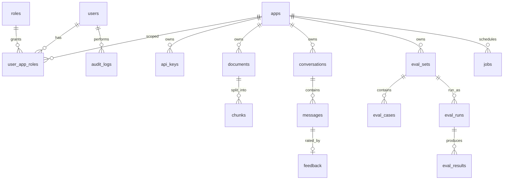

# 数据库设计（PostgreSQL 16，库 `aics`，schema `public`）

## 1. 约定
- 主键 `id uuid`，应用层生成 UUIDv7（时间有序，索引友好）。
- 时间 `timestamptz`，默认 `now()`；所有表有 `created_at`，可变表有 `updated_at`。
- 软删除 `deleted_at timestamptz NULL`；唯一约束用部分索引 `WHERE deleted_at IS NULL`。
- 枚举用 `text + CHECK`（便于迁移），JSON 用 `jsonb`。
- 所有业务表带 `app_id`（除全局表），查询必须带 `app_id` 条件。
- 需要扩展：`pgcrypto`（可选）、无需 pgvector。

## 2. ER 图


## 3. 表结构

### 3.1 users
| 列 | 类型 | 约束 | 说明 |
|---|---|---|---|
| id | uuid | PK | |
| email | citext/text | NOT NULL, 唯一(未删除) | 登录名，小写存储 |
| display_name | text | NOT NULL | |
| password_hash | text | NOT NULL | argon2id |
| is_super_admin | boolean | NOT NULL DEFAULT false | 全局角色 |
| status | text | CHECK in (active, disabled) | |
| failed_logins | int | DEFAULT 0 | 锁定计数 |
| locked_until | timestamptz | NULL | |
| last_login_at | timestamptz | NULL | |
| created_at / updated_at / deleted_at | timestamptz | | |

### 3.2 roles（种子数据，固定 3 行）
| 列 | 类型 | 说明 |
|---|---|---|
| id | text PK | `super_admin` / `app_admin` / `viewer` |
| name | text | 显示名 |
| permissions | jsonb | 如 `["app:write","kb:write","key:write","eval:run","log:read"]` |

### 3.3 user_app_roles（应用级授权）
| 列 | 类型 | 约束 |
|---|---|---|
| user_id | uuid | FK users, PK(user_id, app_id) |
| app_id | uuid | FK apps |
| role_id | text | FK roles，CHECK in (app_admin, viewer) |
| created_at | timestamptz | |

> super_admin 由 `users.is_super_admin` 表示，无需逐个授权。

### 3.4 apps
| 列 | 类型 | 约束 | 说明 |
|---|---|---|---|
| id | uuid | PK | 也是 OpenAI 兼容接口的 `model` |
| name | text | NOT NULL | |
| description | text | | |
| status | text | CHECK in (active, disabled) | disabled 时开放接口返回 403 |
| greeting | text | | 开场白 |
| system_prompt | text | | 角色设定（追加到内置规则后） |
| answer_style | text | DEFAULT 'concise' | concise / detailed / custom |
| fallback_text | text | NOT NULL | 兜底话术 |
| language | text | DEFAULT 'zh-CN' | |
| rag_config | jsonb | NOT NULL | 见下 |
| handoff_config | jsonb | NOT NULL | `{"enabled":true,"keywords":["人工","投诉"],"max_refusals":2,"on_unanswerable":false,"text":"..."}` |
| chunk_config | jsonb | NOT NULL | `{"chunk_size":500,"chunk_overlap":80}` |
| custom_dict | text[] | DEFAULT '{}' | jieba 自定义词 |
| config_version | int | DEFAULT 1 | 每次修改 +1，写入消息便于追溯 |
| index_version | int | DEFAULT 1 | 切块配置变化 +1，触发重建 |
| created_by | uuid | FK users | |
| created_at / updated_at / deleted_at | timestamptz | | |

`rag_config` 默认值：
```json
{"vector_top_k":20,"keyword_top_k":20,"fuse_top_k":30,"rerank_top_n":5,"enable_rerank":true,
 "rerank_threshold":0.35,"judge_with_llm":true,"judge_gray_upper":0.5,"history_turns":6,
 "temperature":0.2,"max_tokens":800,"llm_model":null}
```

### 3.5 api_keys
| 列 | 类型 | 约束 | 说明 |
|---|---|---|---|
| id | uuid | PK | |
| app_id | uuid | FK apps NOT NULL | |
| name | text | NOT NULL | |
| prefix | text | NOT NULL, UNIQUE | 明文前 12 位 `aics_xxxxxxx`，用于查找和展示 |
| key_hash | text | NOT NULL | HMAC-SHA256(pepper, 完整 key) 十六进制 |
| scopes | text[] | NOT NULL | `chat`、`kb:read`、`kb:write` |
| rpm_limit | int | DEFAULT 60 | 每分钟请求 |
| daily_quota | int | NULL | 每日请求上限，NULL 不限 |
| ip_allowlist | cidr[] | NULL | P1 |
| expires_at | timestamptz | NULL | |
| revoked_at | timestamptz | NULL | |
| last_used_at | timestamptz | NULL | 异步更新（Redis 聚合，每分钟落库） |
| created_by | uuid | FK users | |
| created_at | timestamptz | | |

索引：`(app_id)`。

### 3.6 documents
| 列 | 类型 | 约束 | 说明 |
|---|---|---|---|
| id | uuid | PK | |
| app_id | uuid | FK apps NOT NULL | |
| title | text | NOT NULL | 默认文件名 |
| source_type | text | CHECK in (file, url) | |
| source_uri | text | | 原文件名或 URL |
| mime_type | text | | |
| size_bytes | bigint | | |
| content_hash | char(64) | NOT NULL | SHA-256 |
| storage_key | text | | `{app_id}/{id}/original.pdf` |
| status | text | CHECK in (queued, parsing, indexing, done, failed) | |
| progress | smallint | 0–100 | |
| error | text | NULL | 失败原因（用户可读） |
| chunk_count | int | DEFAULT 0 | |
| index_version | int | | 对应 apps.index_version |
| embed_model | text | | 入库时的向量模型 |
| metadata | jsonb | DEFAULT '{}' | 接入方自定义（如分类） |
| created_by | uuid | NULL | 后台用户；API Key 上传为 NULL |
| created_at / updated_at / deleted_at | timestamptz | | |

索引：唯一 `(app_id, content_hash) WHERE deleted_at IS NULL`；`(app_id, status)`；`(app_id, created_at DESC)`。

### 3.7 chunks
| 列 | 类型 | 约束 | 说明 |
|---|---|---|---|
| id | uuid | PK | = Qdrant point id |
| app_id | uuid | NOT NULL | 冗余，便于过滤 |
| document_id | uuid | FK documents ON DELETE CASCADE | |
| ordinal | int | NOT NULL | 文档内序号 |
| heading_path | text | | `A > B > C` |
| text | text | NOT NULL | 正文 |
| search_text | text | NOT NULL | jieba 分词后空格连接 |
| tsv | tsvector | GENERATED ALWAYS AS (to_tsvector('simple', search_text)) STORED | |
| tokens | int | | |
| page_from / page_to | int | NULL | PDF 页码 |
| enabled | boolean | DEFAULT true | |
| created_at | timestamptz | | |

索引：`GIN(tsv)`；`(document_id, ordinal)` 唯一；`(app_id) WHERE enabled`。
> `vector id` 即 `id`，不再单独存列；向量模型记在 documents.embed_model。

### 3.8 conversations
| 列 | 类型 | 说明 |
|---|---|---|
| id | uuid PK | |
| app_id | uuid NOT NULL | |
| channel | text CHECK in (api, openai, debug) | 来源 |
| external_user_id | text NULL | 接入方传的 user_id |
| api_key_id | uuid NULL | |
| created_by | uuid NULL | debug 时为后台用户 |
| title | text | 首个问题前 50 字 |
| message_count | int DEFAULT 0 | |
| refusal_streak | int DEFAULT 0 | 连续拒答次数（转人工规则用） |
| handoff | boolean DEFAULT false | |
| metadata | jsonb | |
| last_message_at | timestamptz | |
| created_at | timestamptz | |

索引：`(app_id, last_message_at DESC)`；`(app_id, external_user_id)`。

### 3.9 messages
| 列 | 类型 | 说明 |
|---|---|---|
| id | uuid PK | |
| conversation_id | uuid FK | |
| app_id | uuid NOT NULL | |
| role | text CHECK in (user, assistant) | |
| content | text | |
| answer_type | text CHECK in (answer, refused, handoff, error) NULL | 仅 assistant |
| rewritten_query | text NULL | |
| citations | jsonb | `[{"n":1,"chunk_id","document_id","title","heading_path","snippet","score"}]` |
| retrieval_trace | jsonb NULL | 各路命中与分数（调试用，保留 30 天后置空） |
| decision_reason | text NULL | |
| handoff | boolean DEFAULT false | |
| degraded | text[] | |
| prompt_tokens / completion_tokens | int | |
| latency_ms / first_token_ms | int | |
| llm_model | text | |
| config_version | int | |
| interrupted | boolean DEFAULT false | |
| created_at | timestamptz | |

索引：`(conversation_id, created_at)`；`(app_id, created_at DESC)`；`(app_id, answer_type)`。
> 量大后按月分区（v2），v1 用保留策略：消息默认保留 180 天（可配）。

### 3.10 feedback
| 列 | 类型 | 说明 |
|---|---|---|
| id | uuid PK | |
| app_id | uuid | |
| message_id | uuid FK UNIQUE | 每条回答一个反馈（可覆盖） |
| rating | smallint CHECK in (1, -1) | |
| comment | text | |
| source | text CHECK in (api, admin) | |
| handled | boolean DEFAULT false | 管理员已处理 |
| created_at / updated_at | timestamptz | |

### 3.11 eval_sets / eval_cases / eval_runs / eval_results
**eval_sets**：`id, app_id, name, description, case_count, created_by, created_at, updated_at, deleted_at`。

**eval_cases**：`id, eval_set_id, question, expected_answer text NULL, expected_document_ids uuid[] DEFAULT '{}', should_refuse boolean DEFAULT false, history jsonb NULL（多轮用例）, tags text[], source text CHECK in (manual, csv, feedback), created_at`。

**eval_runs**：`id, eval_set_id, app_id, status CHECK in (queued, running, done, failed), config_snapshot jsonb, metrics jsonb（见评测指南）, case_total int, case_done int, error text, started_at, finished_at, created_by, created_at`。

**eval_results**：`id, eval_run_id, eval_case_id, answer text, answer_type text, citations jsonb, retrieved_document_ids uuid[], hit_at_5 boolean, citation_hit boolean, correct boolean NULL, faithful boolean NULL, refuse_ok boolean NULL, judge_reason text, latency_ms int, tokens int`。索引 `(eval_run_id)`。

### 3.12 jobs（后台任务记录）
`id, app_id NULL, type CHECK in (ingest, reindex_app, reindex_all, cleanup, eval), target_id uuid, status CHECK in (queued, running, done, failed), progress smallint, payload jsonb, error text, celery_task_id text, created_by, created_at, started_at, finished_at`。索引 `(app_id, created_at DESC)`、`(status)`。

### 3.13 audit_logs
| 列 | 类型 | 说明 |
|---|---|---|
| id | bigint IDENTITY PK | 只追加，用自增更省 |
| actor_type | text CHECK in (user, api_key, system) | |
| actor_id | uuid NULL | |
| app_id | uuid NULL | |
| action | text | 如 `app.update`、`kb.document.delete`、`key.revoke` |
| target_type / target_id | text / uuid | |
| diff | jsonb | `{"before":{},"after":{}}`（敏感字段脱敏） |
| ip | inet | |
| user_agent | text | |
| request_id | text | |
| created_at | timestamptz | |

索引：`(app_id, created_at DESC)`、`(actor_id, created_at DESC)`。应用层不提供修改/删除审计日志的接口；拆分 `aics_app` 账号后（见迁移策略），对此表只授予 INSERT/SELECT。

## 4. DDL 示意（节选，正式以 Alembic 为准）
```sql
CREATE TABLE apps (
  id uuid PRIMARY KEY,
  name text NOT NULL,
  description text,
  status text NOT NULL DEFAULT 'active' CHECK (status IN ('active','disabled')),
  greeting text, system_prompt text,
  answer_style text NOT NULL DEFAULT 'concise',
  fallback_text text NOT NULL DEFAULT '抱歉，这个问题我暂时无法回答，建议联系人工客服。',
  language text NOT NULL DEFAULT 'zh-CN',
  rag_config jsonb NOT NULL, handoff_config jsonb NOT NULL, chunk_config jsonb NOT NULL,
  custom_dict text[] NOT NULL DEFAULT '{}',
  config_version int NOT NULL DEFAULT 1, index_version int NOT NULL DEFAULT 1,
  created_by uuid REFERENCES users(id),
  created_at timestamptz NOT NULL DEFAULT now(),
  updated_at timestamptz NOT NULL DEFAULT now(),
  deleted_at timestamptz
);

CREATE TABLE documents (
  id uuid PRIMARY KEY,
  app_id uuid NOT NULL REFERENCES apps(id),
  title text NOT NULL,
  source_type text NOT NULL CHECK (source_type IN ('file','url')),
  source_uri text, mime_type text, size_bytes bigint,
  content_hash char(64) NOT NULL, storage_key text,
  status text NOT NULL DEFAULT 'queued'
    CHECK (status IN ('queued','parsing','indexing','done','failed')),
  progress smallint NOT NULL DEFAULT 0 CHECK (progress BETWEEN 0 AND 100),
  error text, chunk_count int NOT NULL DEFAULT 0,
  index_version int NOT NULL, embed_model text,
  metadata jsonb NOT NULL DEFAULT '{}',
  created_by uuid REFERENCES users(id),
  created_at timestamptz NOT NULL DEFAULT now(),
  updated_at timestamptz NOT NULL DEFAULT now(),
  deleted_at timestamptz
);
CREATE UNIQUE INDEX uq_documents_app_hash ON documents(app_id, content_hash) WHERE deleted_at IS NULL;
CREATE INDEX ix_documents_app_status ON documents(app_id, status);

CREATE TABLE chunks (
  id uuid PRIMARY KEY,
  app_id uuid NOT NULL,
  document_id uuid NOT NULL REFERENCES documents(id) ON DELETE CASCADE,
  ordinal int NOT NULL,
  heading_path text,
  text text NOT NULL,
  search_text text NOT NULL,
  tsv tsvector GENERATED ALWAYS AS (to_tsvector('simple', search_text)) STORED,
  tokens int, page_from int, page_to int,
  enabled boolean NOT NULL DEFAULT true,
  created_at timestamptz NOT NULL DEFAULT now(),
  UNIQUE (document_id, ordinal)
);
CREATE INDEX ix_chunks_tsv ON chunks USING gin(tsv);
CREATE INDEX ix_chunks_app_enabled ON chunks(app_id) WHERE enabled;
```

## 5. 关键词检索 SQL
```sql
-- :q 为 jieba.lcut_for_search(问题) 用空格连接后的字符串
SELECT c.id, ts_rank_cd(c.tsv, q) AS score
FROM chunks c, plainto_tsquery('simple', :q) q
WHERE c.app_id = :app_id AND c.enabled AND c.tsv @@ q
ORDER BY score DESC
LIMIT :k;
```
> `plainto_tsquery` 默认是 AND 语义，问题较长时容易零命中。实现时把词用 `|` 连接后使用 `to_tsquery('simple', ...)`（OR 语义），并过滤停用词与单字。
