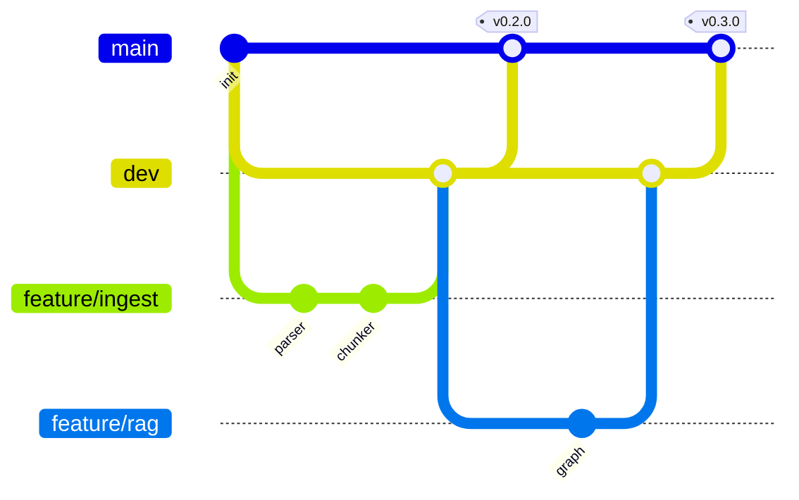

# Git 工作流（公开 GitHub 仓库）

## 1. 分支模型
| 分支 | 用途 | 规则 |
|---|---|---|
| `main` | **GitHub 默认分支**；只放已发布版本，每个提交都对应一个 tag `vX.Y.Z` | 受保护：禁止直接 push、禁止 force push；只接受来自 `dev`（或 `hotfix/*`）的合并 |
| `dev` | 集成分支，所有日常开发在此汇合（不是默认分支，clone 后需 `git switch dev`；PR 目标请选 `dev`） | 受保护：要求 CI 通过；禁止 force push |
| `feature/<简述>` | 从 `dev` 拉出的功能分支，如 `feature/sse-chat` | 完成后 PR 合回 `dev`，合并后删除 |
| `fix/<简述>` | 从 `dev` 拉出的缺陷修复 | 同上 |
| `hotfix/<简述>` | 线上紧急修复，从 `main` 拉出 | 合并到 `main` 打补丁 tag，并**同步合回 `dev`** |



小改动可以直接提交到 `dev`；涉及多个文件或需要评审的功能走 `feature/*` + PR。

## 2. 提交规范（Conventional Commits）
```
<type>(<scope>): <简短描述>

[正文：为什么改、怎么改]
[Refs: #12]
```
- type：`feat` 新功能、`fix` 修复、`docs` 文档、`refactor`、`perf`、`test`、`build`、`ci`、`chore`。
- scope：`api`、`rag`、`ingest`、`kb`、`auth`、`eval`、`web`、`deploy`、`db`。
- 例：`feat(rag): 增加可答性判断节点`、`fix(ingest): 修复 DOCX 表格丢失`。
- 破坏性变更：`feat(api)!: ...` 并在正文写 `BREAKING CHANGE:`。

## 3. 版本号（SemVer）
- `v0.x.y`：开发期，每个里程碑一个次版本（见开发计划）；`v1.0.0` 为首个可上线版本。
- 之后：接口不兼容 → 主版本；新增功能 → 次版本；修复 → 修订号。

## 4. 发布流程（dev → main）
1. 在 `dev` 上确认：CI 绿色、评测未退化、`CHANGELOG.md` 已更新（`## [0.3.0] - 2026-11-xx`）、版本号已改（`backend/pyproject.toml`、`frontend/package.json`）。
2. 提 PR：`dev` → `main`，标题 `release: v0.3.0`，使用 **merge commit**（不 squash，保留历史）。
3. 合并后在 `main` 打附注 tag：`git tag -a v0.3.0 -m "v0.3.0"` 并推送 tag。
4. tag 触发 `release.yml`：构建镜像、创建 GitHub Release（附 CHANGELOG 段落）。
5. 按《应用部署》部署该 tag。

## 5. PR 检查清单
- [ ] 关联 issue / 任务
- [ ] 测试已添加并通过；涉及检索或提示词的改动附评测对比
- [ ] 数据库变更附 Alembic 迁移且可 downgrade
- [ ] 接口变更已更新 `docs/04-api`
- [ ] **没有密钥、密码、真实数据、内网以外的地址**（公开仓库）

## 6. 公开仓库注意事项
- `.env`、`storage/`、`uploads/`、`logs/`、`data/`、`volumes/`、备份文件已在 `.gitignore`；提交前 `git status` 确认。
- pre-commit 与 CI 都运行 gitleaks；一旦误提交密钥：**先轮换密钥**，再清理历史（清理历史不能代替轮换）。
- 文档与示例只使用占位符（`<DEEPSEEK_API_KEY>`、`aics_xxx`）。服务器内网地址 192.168.110.86 可以出现，其他真实 IP、账号、密码不得出现。
- 建议开启 GitHub Secret scanning 与 Push protection、Dependabot。

## 设计讨论
- 涉及设计取舍的讨论（尤其参考竞品 / 开源实现后）必须在 `docs/09-design-discussions/` 新增记录，结论同步到相关设计文档与开发计划后再开始实现；重要决策另写 ADR。
